<h1 align="center">🧩 ARG Decoder</h1>

<p align="center">
  <b>A local node-graph workbench for solving ARG puzzles</b><br>
  <sub>ciphers · encodings · images · audio · video · files · hashes — on one canvas, with an honest auto search<br>
  <i>by Dmytro</i></sub>
</p>

<p align="center">
  
  
  
  
  
  
  
  
</p>

<p align="center">
  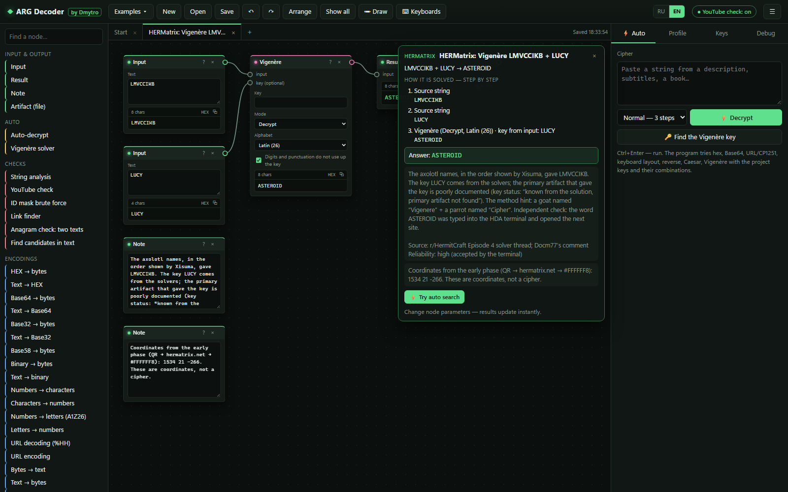
</p>

<p align="center">
  <a href="#-installation"><b>Installation</b></a> ·
  <a href="#-screenshots">Screenshots</a> ·
  <a href="#-what-it-can-do">What it can do</a> ·
  <a href="#-auto-search">Auto search</a> ·
  <a href="#-examples-and-dossiers">Examples</a> ·
  <a href="#-languages">Languages</a> ·
  <a href="#-documentation">Docs</a> ·
  <a href="#-privacy-what-goes-online">Privacy</a> ·
  <a href="#-tests-and-development">Tests</a>
</p>

<p align="center">
  <b>English</b> · <a href="README.ru.md">Русский</a> · <a href="README.uk.md">Українська</a>
</p>

---

ARG Decoder is a universal tool for alternate reality games. You paste a string from a video description, subtitles, a book or a game log, and the program tries chains of known transformations on its own, says how sure it is, and expands any chain into nodes you can edit. Pictures, sound, video and arbitrary files live on the same canvas, so a puzzle that starts as a dark frame and ends as a Vigenère ciphertext stays on one board. Everything runs on your computer.

## ⚡ Installation

### 1. Get the program

| Way | What to do |
|---|---|
| **Download a ZIP** (no Git needed) | Download `arg-decoder-X.Y.Z.zip` from the latest [release](https://github.com/dmytro1253/arg-decoder/releases) (it updates itself; **Code → Download ZIP** works too, but without the signed file list). Unpack it anywhere, for example on the Desktop |
| **Clone with Git** | `git clone https://github.com/dmytro1253/arg-decoder.git` and `cd arg-decoder` |

### 2. Start it: one double-click installs everything

| System | Start file | Notes |
|---|---|---|
| **Windows** | **`Start-Windows.bat`** | Nothing has to be installed beforehand. If there is no Python, the official embedded Python (~11 MB) is downloaded into the program folder. No admin rights, the system is not changed |
| **macOS** | **`Start-Mac.command`** | The first time: right click → **Open** → **Open**. Needs Python 3.9+ from [python.org](https://www.python.org/downloads/macos/) |
| **Linux** | **`./start.sh`** | Needs Python 3.9+ and `python3-venv` |

**The first launch does everything once** (internet needed, about 1–3 minutes):

1. finds a suitable Python or downloads one (Windows);
2. installs numpy;
3. downloads the dictionaries and language models (**~78 MB**) and checks every file by SHA-256;
4. runs a self-test of the Vigenère engine;
5. starts the local server and opens the browser.

**Every next launch of the same file takes about 3 seconds.** Keep the black console window open while you work: the local server runs in it. Close it to quit.

> **Optional GPU.** The full Vigenère key search runs on an NVIDIA card about 10× faster: double-click **`Enable-GPU-Windows.bat`** (installs PyTorch with CUDA, ~2.5 GB) or run `python launcher.py --gpu`.

> **Local OCR comes with the program.** The first start also installs RapidOCR 3.10.0 with ONNX Runtime into `runtime/ocr-python` (your Python stays untouched) and three models (~26 MB) into `data/ocr`, each checked by SHA-256. If that fails, OCR falls back to tesseract.js and `python launcher.py --ocr` retries; `--no-ocr` skips it.

### 3. Or install by hand from the console

```bash
git clone https://github.com/dmytro1253/arg-decoder.git
cd arg-decoder
python -m venv .venv
# Windows: .venv\Scripts\activate     Linux / macOS: source .venv/bin/activate
python -m pip install -r requirements.txt
python setup_data.py          # dictionaries and language models, checked by SHA-256
python server.py              # http://127.0.0.1:8765 opens in the browser
```

| Command | What it does |
|---|---|
| `python launcher.py` | the same as the start files: choose Python, install, check, run |
| `python launcher.py --repair` | redo the whole setup |
| `python launcher.py --offline` | never download anything |
| `python launcher.py --check` | list the Pythons found and what they have |
| `python launcher.py --update` | check for a new version, download it, verify the signature and install it |
| `python launcher.py --check-update` | only say whether a new version exists |
| `python launcher.py --verify` | compare every program file with the signed build list |
| `python launcher.py --rollback` | bring back the version that was installed before the last update |
| `python server.py --port 8798 --no-browser` | run the server on another port without opening a browser |

Without Python at all you can open `web/index.html` directly: ciphers, images and examples work; the Python Vigenère engine, OCR and link checks need the local server.

### 4. Updates

The program knows its exact build: a release carries `build.json` (version, commit and the SHA-256 of every program file) and `build.sig`, an Ed25519 signature of that list made with the author's key. The **Debug** tab shows the version, commit, build id and signature, and **Check files** finds changed or missing files.

At start the page asks the local server whether a newer release exists (GitHub is asked at most once per 6 hours; the check can be turned off in **Debug**, and `--offline` disables it). A bar offers **Update**:

1. the server downloads the release archive and checks the signature of its file list with the public key built into the program; a forged or damaged archive is refused even if it is served by GitHub;
2. the archive is unpacked into `runtime/update/staging`, and every file is compared with the signed list; extra files, `../` paths and the `data/`, `runtime/`, `.venv/` folders are refused;
3. **Restart and install**: the launcher copies the files it replaces or deletes into `runtime/update/backup`, writes a journal, installs, and checks every file again. On any error everything is put back; an install interrupted by a power cut is rolled back at the next start. `python launcher.py --rollback` restores the previous version.

Dictionaries, projects, `runtime/` and `.venv/` are never touched. Only files listed in the previous signed build are deleted. A Git clone is not updated from an archive: use `git pull`.

<details>
<summary><b>What the launcher does in detail</b></summary>

1. `launcher.py` picks the best Python: with numpy and CUDA, else with numpy, else any 3.9+. On Windows without Python it uses `runtime/python`, downloaded by `tools/bootstrap-python.ps1`.
2. If that Python has no numpy, it installs it (into `.venv`, or straight into the embedded Python).
3. `setup_data.py` downloads `arg-decoder-data-v1.zip` from the GitHub release (address in `config/release.json` or the `ARGDEC_DATA_URL` variable), resumes interrupted downloads, and checks the archive and every file against `data.manifest.json`. If the release is unavailable, it builds the data from the original public sources.
4. A self-test decodes a known example; success is written to `runtime/setup-done.json`, so later launches skip all of this.
5. `server.py` starts on `127.0.0.1:8765` and the browser opens.
</details>

## 🖼 Screenshots

All screenshots are captures of the running program. Any example opens straight from a link such as `http://127.0.0.1:8765/?preset=kf2-columnar&lang=en`.

<table>
<tr>
<td width="50%">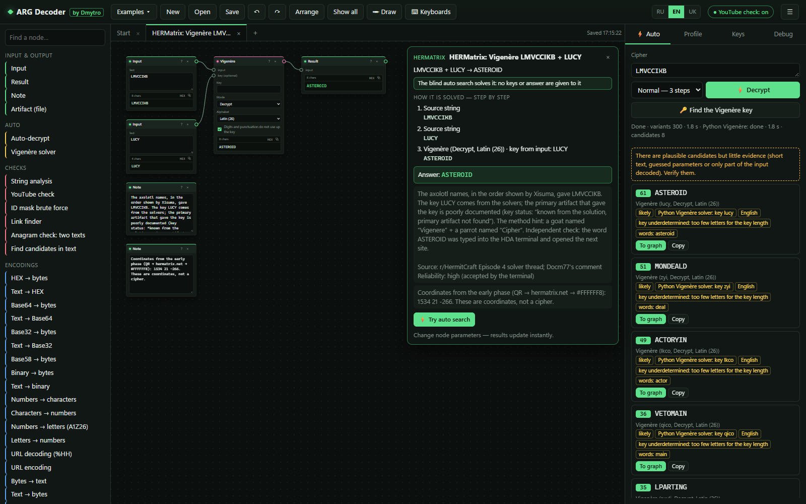<br>
<b>Auto search with the Python engine.</b> <code>LMVCCIKB</code> without a key: the local Python solver finds <code>ASTEROID</code> (key <code>lucy</code>). The result is marked <i>likely</i>, not <i>confident</i>: eight letters are too few to prove a four-letter key.</td>
<td width="50%">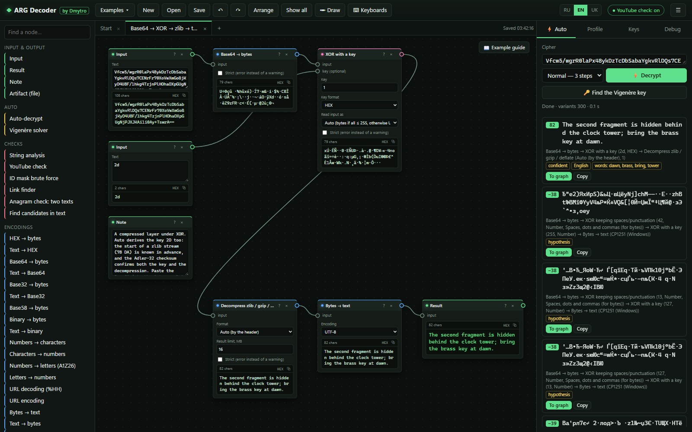<br>
<b>Compressed layers under XOR.</b> Base64 → XOR → zlib → text as a graph. Auto finds the same chain by itself: the zlib header gives the XOR key <code>2D</code>, and the Adler-32 checksum confirms it.</td>
</tr>
<tr>
<td>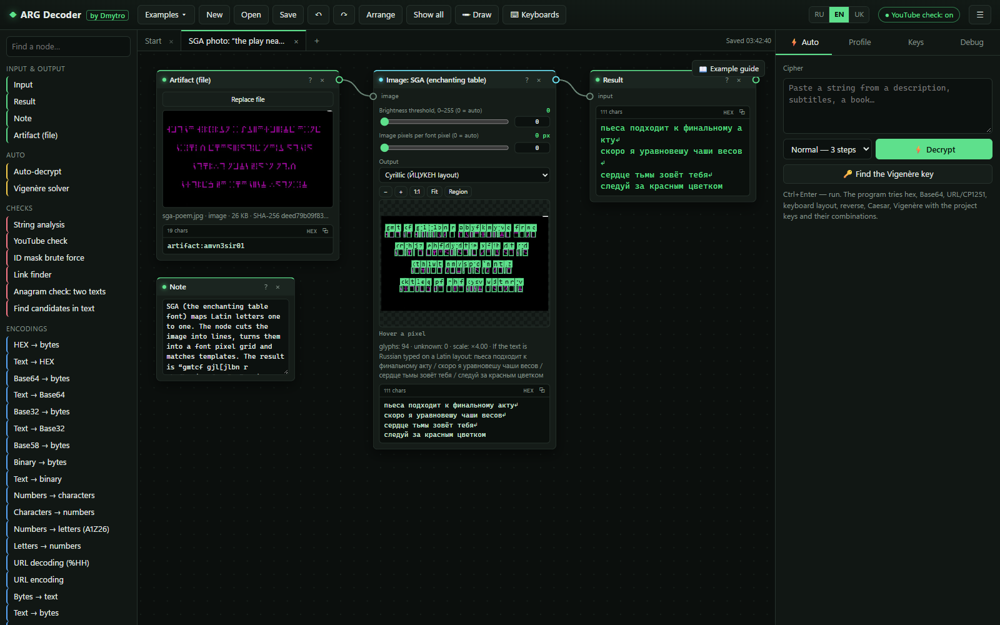<br>
<b>SGA from a photo.</b> The enchanting-table reader recognises all 94 glyphs of a real photo; Russian typed on an English layout is turned back into Cyrillic.</td>
<td>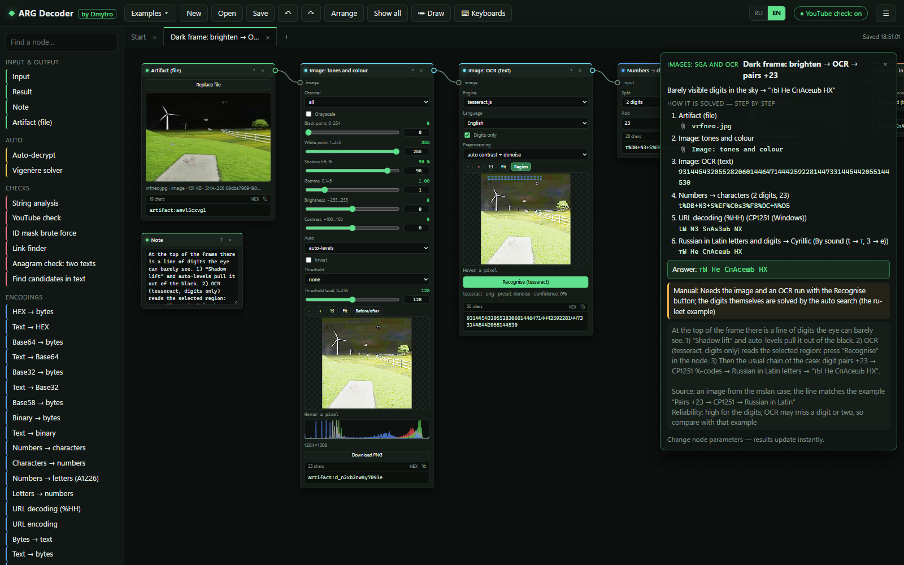<br>
<b>From a dark frame to the answer.</b> Shadow lift pulls digits out of a black sky, local OCR reads them, and the chain pairs +23 → CP1251 → Russian in Latin letters finishes the job.</td>
</tr>
<tr>
<td>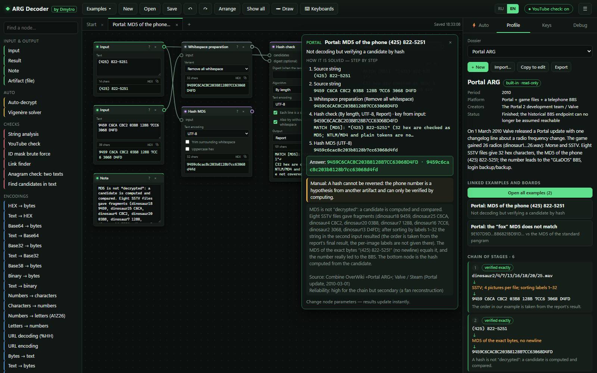<br>
<b>Dossiers.</b> 17 built-in ARG dossiers with stages, sources and reliability, linked to their examples; write your own and keep them in the project file.</td>
<td>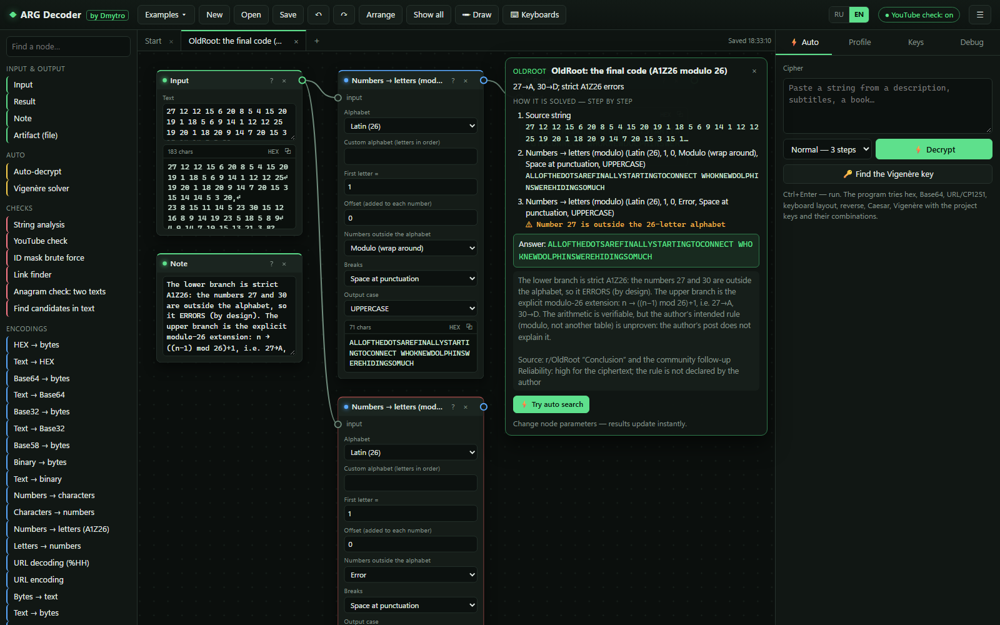<br>
<b>Source discrepancies are shown, not hidden.</b> OldRoot's final code: strict A1Z26 fails on 27 and 30, the modulo-26 branch reads the message.</td>
</tr>
<tr>
<td>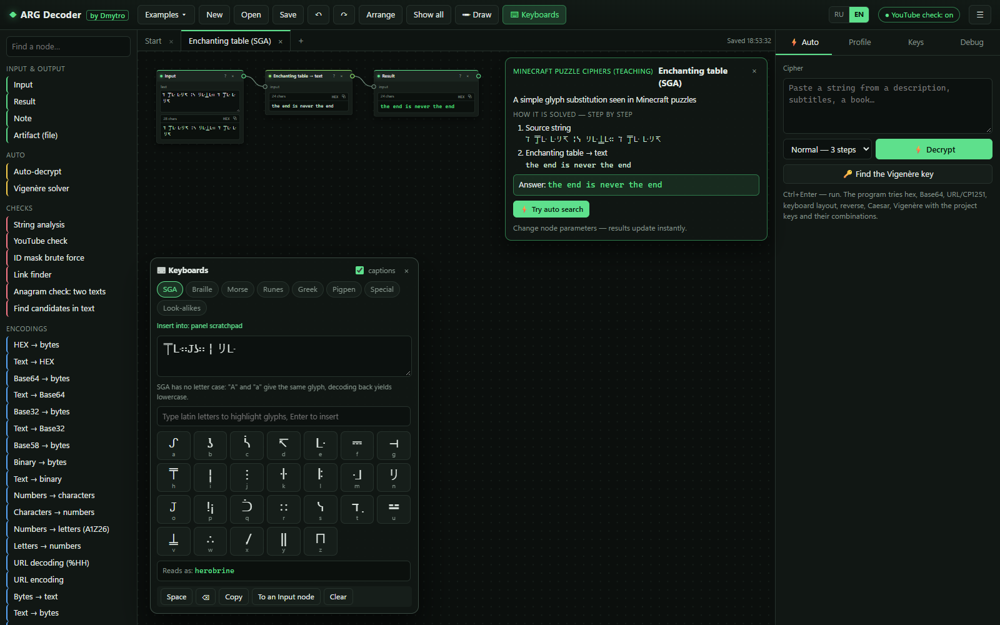<br>
<b>On-screen keyboards.</b> SGA, Braille, Morse, runes, Greek, pigpen, special characters, look-alike letters.</td>
<td>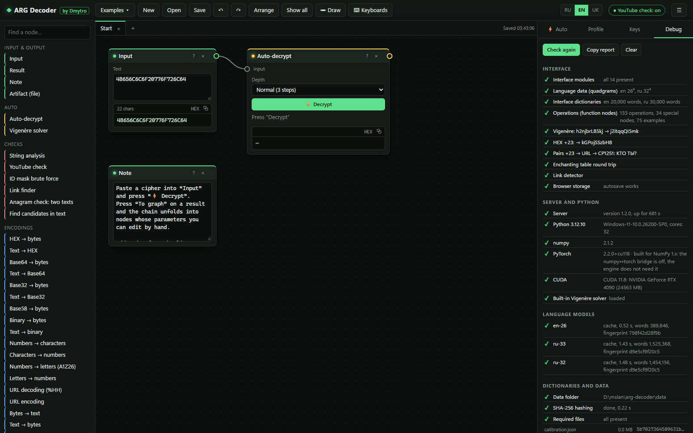<br>
<b>Debug tab.</b> Modules, self-tests, Python, numpy, PyTorch, CUDA, model load times, dictionary hashes; one button copies a report.</td>
</tr>
<tr>
<td>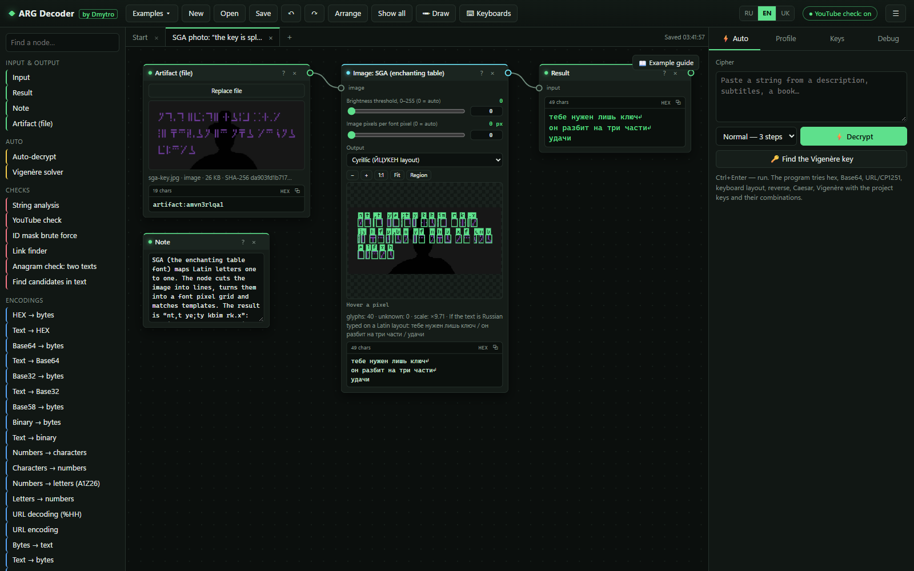<br>
<b>SGA on a dark photo.</b> Otsu binarisation separates the enchanting-table glyphs from a dark background with a silhouette; the reader turns them back into Russian.</td>
<td>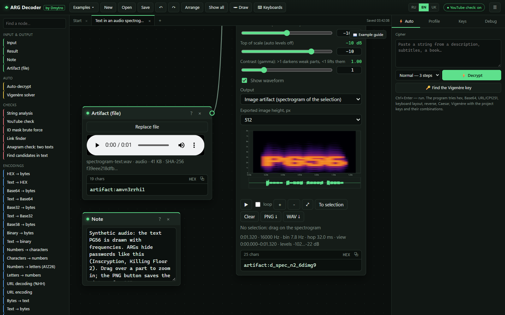<br>
<b>Text hidden in audio.</b> The spectrogram shows the word PG56 drawn with frequencies. Drag to zoom, save a PNG for OCR; Morse, DTMF and SSTV decoders are next to it.</td>
</tr>
</table>

## 🧰 What it can do

**167 nodes:** 133 operations (they are also the steps of the auto search) and 34 special nodes. Every node has a **?** card with a before/after example and a Wikipedia link. The full list with parameters is in the [function reference](docs/FUNCTIONS.md).

| Area | Highlights |
|---|---|
| **Encodings** | HEX, Base64/32/58/85/91, binary, octal, numbers ↔ characters with a shift (+23), A1Z26 and modulo 26, URL (UTF-8 / CP1251), escapes, Morse, EBCDIC, uuencode, quoted-printable, Punycode, zlib / gzip / raw deflate (auto-detected, size-limited, checksums verified) |
| **Classical ciphers** | Caesar (26/32/33 letters), ROT-n, Atbash, affine, substitution, Vigenère / Gronsfeld, Beaufort, autokey, Porta, Bifid, Trifid, ADFGVX, Playfair, four-square, Hill, Chaocipher, XOR, Enigma I/M3/M4 |
| **Transpositions** | rail fence, columnar (with a search for an unknown column order), Myszkowski, scytale, route, grid rotate/flip |
| **ARG and Minecraft** | enchanting table (SGA), Polybius, tap code, Bacon, phone keypad, leet, keyboard layouts EN ↔ RU / UK, Minecraft § codes, runes, Braille, pigpen, NATO phonetic |
| **Hidden** | look-alike letters, zero-width characters, acrostic, book cipher (with exact whitespace), letter case → bits |
| **Images** | levels, shadow lift, gamma, channels, threshold (Otsu), crop/rotate, bit planes, LSB, metadata, two-image difference/XOR/blend, OCR (Minecraft font → RapidOCR, optional → tesseract; EN/RU/UK, raw answers and line boxes kept), Minecraft-font digits, SGA reader, QR (with finder-pattern repair), bit groups → grid rows → image |
| **Audio and video** | spectrogram + waveform, Morse, DTMF, SSTV (Robot 36, Martin, Scottie; mode from VIS or from the line period), raw PCM import, video frame stepper with frame/audio extraction |
| **Files** | format by signature, data after the end of a file, embedded files, strings, ZIP/JAR with ZipCrypto and nested archives, RAR 4/5 (also with encrypted headers) and 7z (also AES) through 7-Zip WebAssembly, Java class constants, log viewer, bytes ↔ file, binary join of file parts |
| **Hashes and crypto** | MD5, SHA-1/256/512, CRC32, hash check against candidates, OpenSSL `Salted__` inspector and decrypt (AES, RC4), raw RC4 |
| **Links and IDs** | plain, defanged and reversed URLs, YouTube/Drive/Catbox/Pastebin IDs, existence checks on demand, ID mask brute force |
| **Workspace** | boards (tabs), drawing layer, on-screen keyboards, project files with attachments, key bank, profiles, undo/redo, copy/paste between boards |

## 🤖 Auto search

The **⚡ Auto** panel and the *Auto-decrypt* node run a beam search over chains of up to four steps (58 of the 133 operations have their own probes; the rest are manual nodes or need a key), scored by English, Russian and Ukrainian language models (quadgrams + dictionaries) and by structure (links, IDs, coordinates, file paths, numbers).

- **Honest statuses.** Each result is *confident*, *likely*, *format recognised*, *part of the input* or *hypothesis*, and the search ends with a verdict, including **"answer not determined"**. Format checks are strict, and the penalty for trying many variants fades only when the text really reads.
- **Before searching** it evaluates arithmetic exactly, reports hash digests and opaque tokens as such, and recognises coordinates and file paths.
- **The full Python Vigenère engine** (CPU or CUDA) starts in parallel when the input looks like a letter ciphertext, within a time budget and with cancellation; every result shows where it came from.
- **Compound messages** (different lines encrypted differently) are solved line by line; **unknown columnar transpositions** are searched with the language of the text, and scrambled links by their format; a cut-out fragment is never presented as the answer to the whole input.
- **Format layers are peeled first**, however many there are (Base64 in Base64, hex(hex), %25XX), with depth limits and cycle protection; the Python engine also gets the intermediate letter layers (Base64 → Vigenère).
- **A decoded format is not yet an answer.** Short or unreadable decoder output is *format decoded, answer not confirmed*; a reversed link or a link inside an unreadable message confirms only itself; two equally readable word orders make the leader *likely*.

Measured blind (neutral profile, empty key bank, no answer or key passed) on the independent review set of 24.10.2026 and on OCR images; details and machine-readable results are in the final report:

| | Before | Now |
|---|---:|---:|
| Generated review set, 599 encrypted inputs: exact answer first | 507 | **578** |
| … leader wrongly marked "confident" | 29 | **0** |
| Unknown columnar transposition (18 inputs) | 3 | **14** |
| Base64-wrapped Vigenère through the real server (3) | 0 | **3** |
| New independent OCR images (34): exact | 25 | **34** (auto with RapidOCR) |

## 🧩 Examples and dossiers

The **Examples** menu holds **75 ready boards** from documented solutions of real ARGs (OldRoot, HERMatrix, Endermite, Cicada 3301, Portal, Sombra, Killing Floor 2, Dr. Langeskov, 76543, Steam Winter 2015 and more), plus teaching sets. Each example says how it is solved:

| Mark | Meaning |
|---|---|
| 🟢 **blind auto** | the auto search solves it with no keys and no answer given |
| 🟢 **blind auto + server** | the same, with the local Python engine |
| 🟡 **key** | a manual solution with a key obtained at an earlier stage |
| 🟡 **context** | the program does the computing part; a human step is needed |

The **Dossier** tab shows **17 built-in dossiers** (one per ARG: period, platform, stages, techniques, sources, open questions). You can write your own dossiers; they are stored in the project file.

## 🌐 Languages

| Area | Languages |
|---|---|
| Interface | **English, Russian, Ukrainian** (switch **RU / EN / UK** in the top bar; the default follows the browser language) |
| Documentation | English, Russian, Ukrainian |
| Auto-search language scoring | English, Russian, Ukrainian |
| Vigenère solvers (browser and Python) | en-26, ru-32/33, uk-32/33, chosen automatically |
| Keyboard layout fix | EN ↔ RU, EN ↔ UK |
| OCR | English, Russian, Ukrainian |

## 📚 Documentation

| Document | What is inside |
|---|---|
| [How it works](docs/HOW-IT-WORKS.md) · [RU](docs/HOW-IT-WORKS.ru.md) · [UK](docs/HOW-IT-WORKS.uk.md) | installation, the node graph, text scoring, the auto search and its statuses, the Vigenère engines, OCR, SGA, SSTV, files, security |
| [Function reference](docs/FUNCTIONS.md) · [RU](docs/FUNCTIONS.ru.md) · [UK](docs/FUNCTIONS.uk.md) | every operation and node with its parameters, every example, dossier and keyboard (generated from the code) |
| [CHANGELOG](CHANGELOG.md) · [ROADMAP](ROADMAP.md) | what changed and what is still open |

## 🔒 Privacy: what goes online

Almost everything is local. The server listens on `127.0.0.1` only, checks the `Host` header and requires a header that only the interface sends, so other websites in your browser cannot talk to it. No telemetry, no accounts, no CDN scripts.

| What | When | Where to |
|---|---|---|
| First setup | first launch only | python.org (Python on Windows), PyPI (numpy, optional PyTorch), the GitHub release (dictionaries) |
| OCR setup | first launch (or `launcher.py --ocr`) | PyPI (RapidOCR, ONNX Runtime), modelscope.cn (three ONNX models, SHA-256 checked) |
| YouTube check | only when you press it | `youtube.com/oembed` |
| Update check | at start, at most once per 6 hours (can be turned off in Debug) | `api.github.com` (release list), then the release files on `github.com` when you press Update |
| Link check | only when you press it | a fixed list of known file and paste hosts; redirects are never followed |
| Wikipedia in help cards | only when you click | your browser |

## ⚠ Known limitations

- **Enigma** and other keyed machines need the settings from the puzzle: Auto does not search them.
- **Short keyed ciphers** without a key are underdetermined: the program shows candidates and says "answer not determined" instead of guessing.
- **No** OpenPGP, OutGuess, speech recognition, or own decoder for barcodes other than QR (those use the browser's `BarcodeDetector`).
- SSTV modes Robot 72, PD and Scottie DX are not implemented; a decoded picture is a result to check, not proof.
- OCR, the Python engine and link checks need the local server (not `file://`).

## ✅ Tests and development

```bash
node --test                                              # 554 tests: engine, solver, examples, images, audio, files, OCR, archives, i18n
python -m unittest discover -s tests -p "test_*.py"      # server, data installer, Vigenère engine
node tools/check_i18n.js                                 # interface strings outside T('ru', 'en')
node tools/i18n_uk.js check                              # Ukrainian dictionary is complete
node tools/gen_functions_doc.js                          # rebuild docs/FUNCTIONS*.md
```

Tests on original ARG media (SSTV recordings, QR, PDF halves, RAR) run when the folder with those files is given in `ARGDEC_ORIGINALS`; otherwise they are skipped.

<details>
<summary><b>Project structure</b></summary>

```
Start-Windows.bat / Start-Mac.command / start.sh   one-click start (first run sets everything up)
Enable-GPU-Windows.bat     PyTorch with CUDA (optional)
launcher.py                picks Python, installs dependencies, starts the server
setup_data.py              downloads and checks the dictionaries (SHA-256)
setup_ocr.py / ocr_backend.py   local RapidOCR, installed by the first start (packages in runtime/ocr-python, models in data/ocr)
server.py / backend.py     local server (127.0.0.1 only) and the Python Vigenère engine jobs
updater.py / ed25519_ref.py   exact build, update check, signed install with rollback
tools/release.py           builds and signs a release (author only)
vigenere/                  built-in Vigenère solver (MIT, by Dmytro)
data/                      corpora, EN/RU/UK dictionaries, language-model cache (~300 MB, downloaded)
docs/                      HOW-IT-WORKS, FUNCTIONS (EN/RU/UK), screenshots
tests/                     Node and Python tests
tools/                     language data, i18n, docs and data-archive builders
web/index.html             the interface
web/js/solver*.js          auto search: beam search, evidence and statuses, engines, crackers
web/js/ops*.js             operations
web/js/i18n*.js            interface languages (the Ukrainian dictionary is generated)
web/js/image/, media/, files/   images, audio/video, files
web/vendor/                tesseract.js 5.1.1 (eng/rus/ukr), jsQR 1.4.0, 7-Zip 24.09 WebAssembly (7z-wasm 1.2.0)
```
</details>

## ⚖ License and credits

**License: [MIT](LICENSE)**, © 2026 Dmytro. Bundled third-party components and downloaded data keep their own licenses (below and in [THIRD_PARTY_NOTICES.md](THIRD_PARTY_NOTICES.md)).

**Author:** Dmytro.

| Bundled component | Version | License | Used for |
|---|---|---|---|
| [tesseract.js](https://github.com/naptha/tesseract.js) + core | 5.1.1 | Apache-2.0 | local OCR |
| [tessdata_fast](https://github.com/tesseract-ocr/tessdata_fast) (eng, rus, ukr) | 4.1.0 | Apache-2.0 | OCR language data |
| [jsQR](https://github.com/cozmo/jsQR) | 1.4.0 | Apache-2.0 | QR codes |
| [7-Zip WebAssembly](https://github.com/use-strict/7z-wasm) (7-Zip 24.09) | 1.2.0 | LGPL-2.1+ with the unRAR restriction | RAR/7z extraction |

Data sources and their licenses are listed in [THIRD_PARTY_NOTICES.md](THIRD_PARTY_NOTICES.md).

## 🙏 Thanks

A big thank-you to **Polus_Landau** for help with solving ARGs and for the ideas that shaped this tool.
