<h1 align="center">🧩 ARG Decoder</h1>

<p align="center">
  <b>Локальная рабочая среда на графе нод для решения ARG-головоломок</b><br>
  <sub>шифры · кодировки · изображения · аудио · видео · файлы · хеши — на одном холсте, с честным автопоиском<br>
  <i>by Dmytro</i></sub>
</p>

<p align="center">
  
  
  
  
  
  
  
  
</p>

<p align="center">
  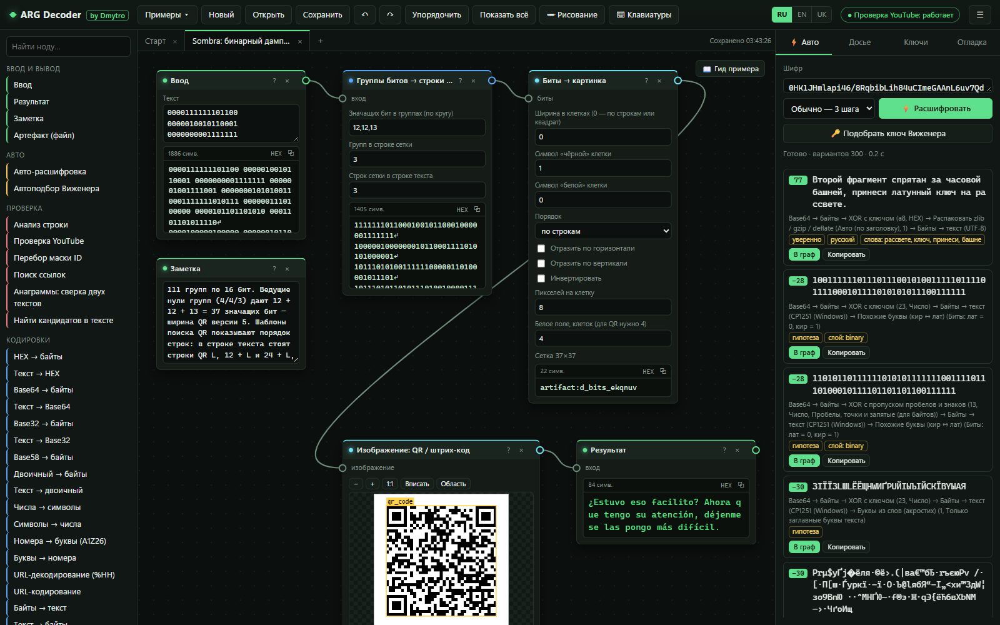
</p>

<p align="center">
  <a href="#-установка"><b>Установка</b></a> ·
  <a href="#-скриншоты">Скриншоты</a> ·
  <a href="#-возможности">Возможности</a> ·
  <a href="#-автопоиск">Автопоиск</a> ·
  <a href="#-примеры-и-досье">Примеры</a> ·
  <a href="#-языки">Языки</a> ·
  <a href="#-документация">Документация</a> ·
  <a href="#-приватность-что-уходит-в-сеть">Приватность</a> ·
  <a href="#-тесты-и-разработка">Тесты</a>
</p>

<p align="center">
  <a href="README.md">English</a> · <b>Русский</b> · <a href="README.uk.md">Українська</a>
</p>

---

ARG Decoder — универсальный инструмент для игр в альтернативной реальности. Вы вставляете строку из описания видео, субтитров, книги или игрового лога, и программа сама перебирает цепочки известных преобразований, оценивает свою уверенность и разворачивает любую цепочку в ноды, которые можно править. Изображения, звук, видео и произвольные файлы лежат на том же холсте, поэтому головоломка, которая начинается тёмным кадром, а заканчивается шифртекстом Виженера, остаётся на одной доске. Всё работает на вашем компьютере.

## ⚡ Установка

### 1. Получите программу

| Способ | Что сделать |
|---|---|
| **Скачать ZIP** (Git не нужен) | Скачайте `arg-decoder-X.Y.Z.zip` из последнего [релиза](https://github.com/dmytro1253/arg-decoder/releases) (он обновляется сам; **Code → Download ZIP** тоже подходит, но без подписанного списка файлов). Распакуйте куда угодно, например на рабочий стол |
| **Клонировать через Git** | `git clone https://github.com/dmytro1253/arg-decoder.git` и `cd arg-decoder` |

### 2. Запустите: один двойной щелчок устанавливает всё

| Система | Файл запуска | Примечания |
|---|---|---|
| **Windows** | **`Start-Windows.bat`** | Ничего не нужно устанавливать заранее. Если Python нет, официальный встраиваемый Python (~11 МБ) скачивается в папку программы. Права администратора не нужны, система не меняется |
| **macOS** | **`Start-Mac.command`** | В первый раз: правый щелчок → **Открыть** → **Открыть**. Нужен Python 3.9+ с [python.org](https://www.python.org/downloads/macos/) |
| **Linux** | **`./start.sh`** | Нужны Python 3.9+ и `python3-venv` |

**Первый запуск делает всё один раз** (нужен интернет, около 1–3 минут):

1. находит подходящий Python или скачивает его (Windows);
2. устанавливает numpy;
3. скачивает словари и языковые модели (**~78 МБ**) и проверяет каждый файл по SHA-256;
4. прогоняет самотест движка Виженера;
5. запускает локальный сервер и открывает браузер.

**Каждый следующий запуск того же файла занимает около 3 секунд.** Не закрывайте чёрное окно консоли, пока работаете: в нём работает локальный сервер. Закройте его, чтобы выйти.

> **GPU (по желанию).** Полный перебор ключей Виженера на видеокарте NVIDIA идёт примерно в 10 раз быстрее: дважды щёлкните **`Enable-GPU-Windows.bat`** (ставит PyTorch с CUDA, ~2,5 ГБ) или выполните `python launcher.py --gpu`.

> **Локальный OCR ставится вместе с программой.** Первый запуск ставит и RapidOCR 3.10.0 с ONNX Runtime в `runtime/ocr-python` (ваш Python не меняется), и три модели (~26 МБ) в `data/ocr`, каждую со сверкой SHA-256. Если установка не удалась, OCR работает через tesseract.js, а `python launcher.py --ocr` повторит её; `--no-ocr` пропускает OCR.

### 3. Или установите вручную из консоли

```bash
git clone https://github.com/dmytro1253/arg-decoder.git
cd arg-decoder
python -m venv .venv
# Windows: .venv\Scripts\activate     Linux / macOS: source .venv/bin/activate
python -m pip install -r requirements.txt
python setup_data.py          # dictionaries and language models, checked by SHA-256
python server.py              # http://127.0.0.1:8765 opens in the browser
```

| Команда | Что делает |
|---|---|
| `python launcher.py` | то же, что файлы запуска: выбрать Python, установить, проверить, запустить |
| `python launcher.py --repair` | выполнить всю настройку заново |
| `python launcher.py --offline` | ничего не скачивать |
| `python launcher.py --check` | показать найденные Python и что в них есть |
| `python launcher.py --update` | проверить новую версию, скачать, сверить подпись и установить |
| `python launcher.py --check-update` | только узнать, есть ли новая версия |
| `python launcher.py --verify` | сверить каждый файл программы с подписанным списком сборки |
| `python launcher.py --rollback` | вернуть версию, стоявшую до последнего обновления |
| `python server.py --port 8798 --no-browser` | запустить сервер на другом порту, не открывая браузер |

Совсем без Python можно открыть `web/index.html` напрямую: шифры, изображения и примеры работают; движку Виженера на Python, OCR и проверке ссылок нужен локальный сервер.

### 4. Обновления

Программа знает свою точную сборку: в релизе лежат `build.json` (версия, коммит и SHA-256 каждого файла программы) и `build.sig` — подпись Ed25519 этого списка ключом автора. Вкладка **Отладка** показывает версию, коммит, номер сборки и подпись, а кнопка **Проверить файлы** находит изменённые и пропавшие файлы.

При запуске страница спрашивает локальный сервер, нет ли релиза новее (GitHub спрашивается не чаще раза в 6 часов; проверку можно выключить в **Отладке**, а `--offline` отключает её). Появляется полоса с кнопкой **Обновить**:

1. сервер скачивает архив релиза и проверяет подпись списка файлов открытым ключом, встроенным в программу; поддельный или повреждённый архив отклоняется, даже если его отдаёт GitHub;
2. архив распаковывается в `runtime/update/staging`, и каждый файл сверяется с подписанным списком; лишние файлы, пути `../` и папки `data/`, `runtime/`, `.venv/` отклоняются;
3. **Перезапустить и установить**: запускатор копирует заменяемые и удаляемые файлы в `runtime/update/backup`, пишет журнал, устанавливает и снова проверяет каждый файл. При любой ошибке всё возвращается назад; установка, прерванная выключением питания, откатывается при следующем запуске. `python launcher.py --rollback` возвращает прошлую версию.

Словари, проекты, `runtime/` и `.venv/` не трогаются. Удаляются только файлы из списка прошлой подписанной сборки. Клон Git архивом не обновляется: используйте `git pull`.

<details>
<summary><b>Что лаунчер делает подробно</b></summary>

1. `launcher.py` выбирает лучший Python: с numpy и CUDA, иначе с numpy, иначе любой 3.9+. В Windows без Python он использует `runtime/python`, скачанный скриптом `tools/bootstrap-python.ps1`.
2. Если в этом Python нет numpy, лаунчер его устанавливает (в `.venv` или прямо во встраиваемый Python).
3. `setup_data.py` скачивает `arg-decoder-data-v1.zip` из релиза на GitHub (адрес в `config/release.json` или в переменной `ARGDEC_DATA_URL`), докачивает прерванные загрузки и сверяет архив и каждый файл с `data.manifest.json`. Если релиз недоступен, данные собираются из исходных открытых источников.
4. Самотест расшифровывает известный пример; успех записывается в `runtime/setup-done.json`, поэтому последующие запуски всё это пропускают.
5. `server.py` стартует на `127.0.0.1:8765`, и открывается браузер.
</details>

## 🖼 Скриншоты

Все скриншоты сняты с работающей программы. Любой пример открывается сразу по ссылке вида `http://127.0.0.1:8765/?preset=kf2-columnar&lang=ru`.

<table>
<tr>
<td width="50%">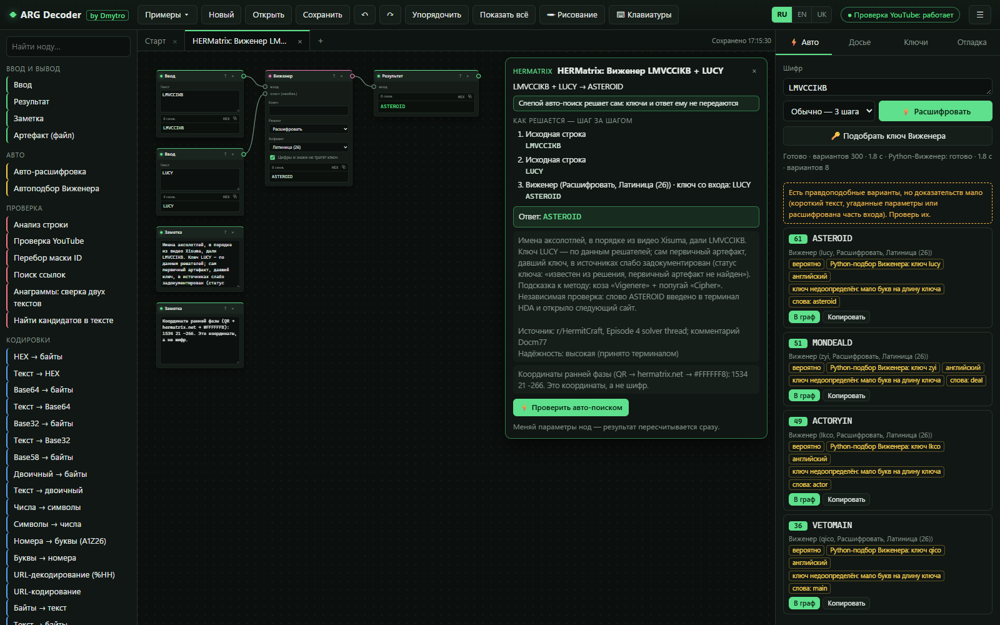<br>
<b>Автопоиск с движком на Python.</b> <code>LMVCCIKB</code> без ключа: локальный решатель на Python находит <code>ASTEROID</code> (ключ <code>lucy</code>). Результат помечен как <i>вероятно</i>, а не <i>уверенно</i>: восьми букв мало, чтобы доказать четырёхбуквенный ключ.</td>
<td width="50%">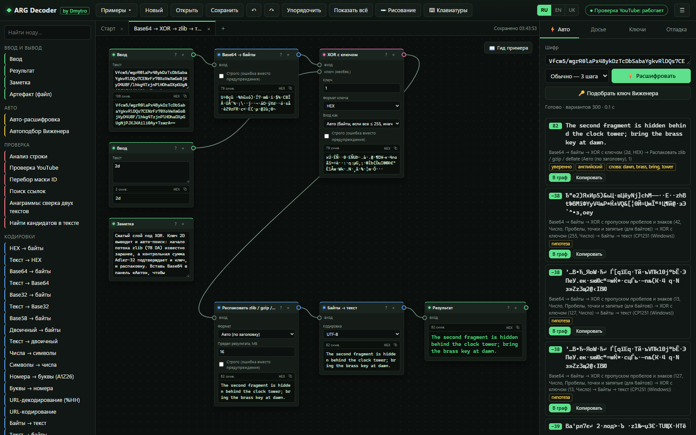<br>
<b>Сжатые слои под XOR.</b> Base64 → XOR → zlib → текст в виде графа. Auto находит ту же цепочку сам: заголовок zlib даёт ключ XOR <code>2D</code>, а контрольная сумма Adler-32 его подтверждает.</td>
</tr>
<tr>
<td>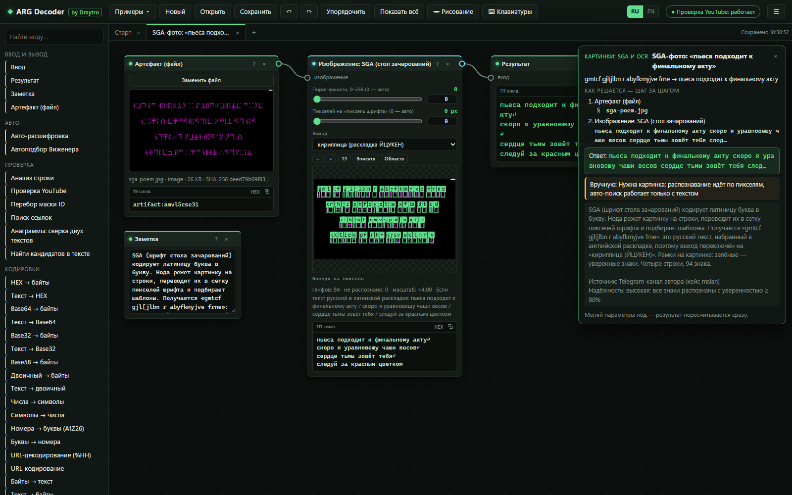<br>
<b>SGA по фотографии.</b> Читалка зачарованного стола распознаёт все 94 глифа реальной фотографии; русский текст, набранный на английской раскладке, превращается обратно в кириллицу.</td>
<td>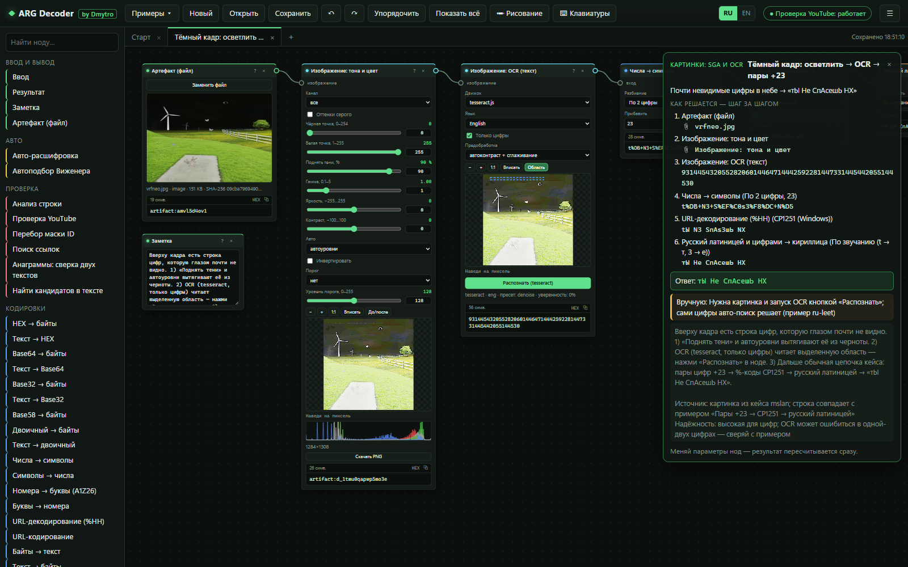<br>
<b>От тёмного кадра до ответа.</b> Подъём теней вытаскивает цифры из чёрного неба, локальный OCR их читает, а цепочка «пары +23 → CP1251 → русский латиницей» довершает дело.</td>
</tr>
<tr>
<td>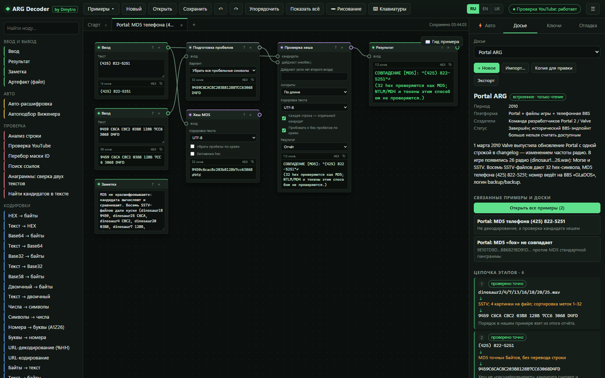<br>
<b>Досье.</b> 17 встроенных досье на ARG с этапами, источниками и степенью достоверности, связанные со своими примерами; пишите собственные и храните их в файле проекта.</td>
<td>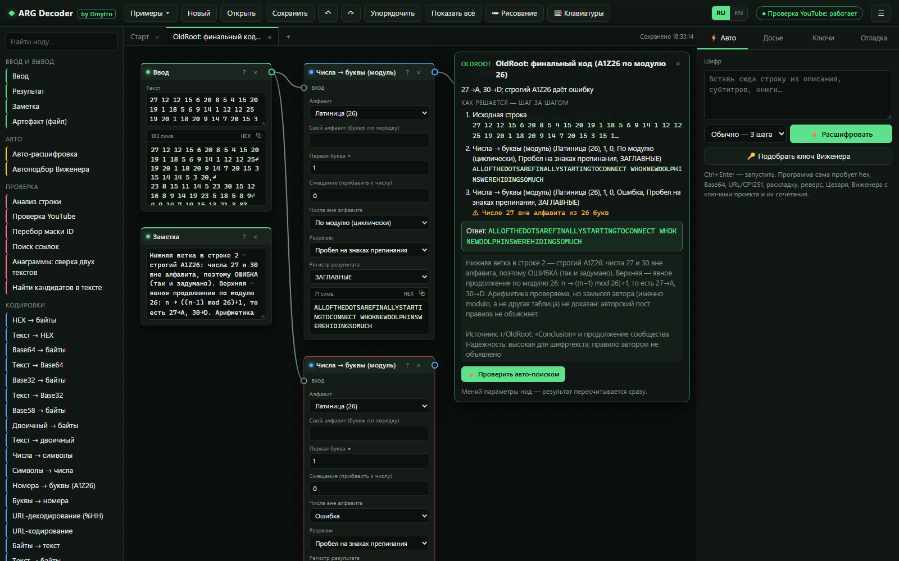<br>
<b>Расхождения в источниках показаны, а не скрыты.</b> Финальный код OldRoot: строгий A1Z26 ломается на 27 и 30, ветка по модулю 26 читает сообщение.</td>
</tr>
<tr>
<td>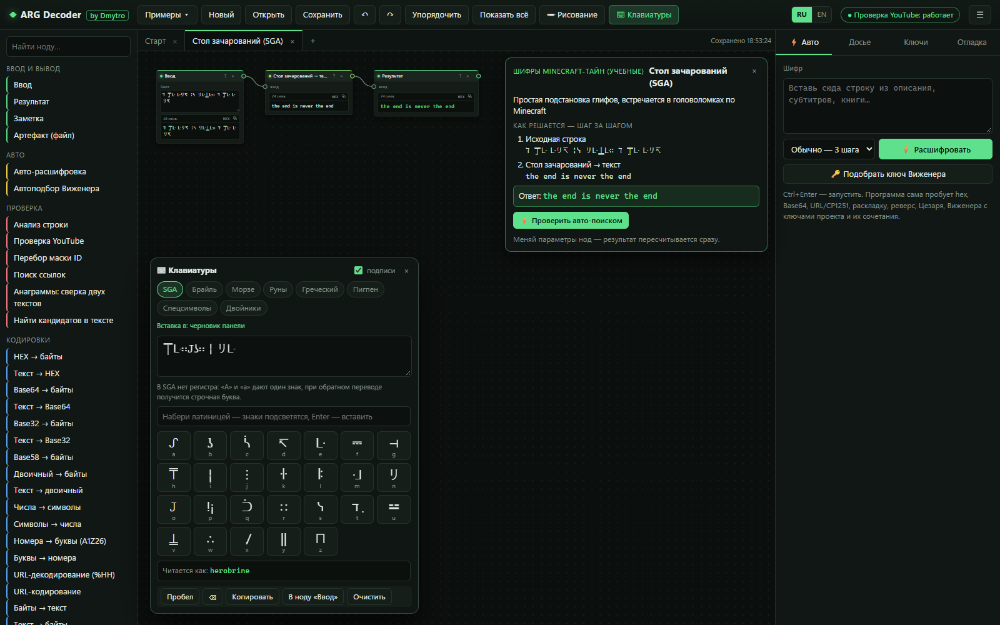<br>
<b>Экранные клавиатуры.</b> SGA, Брайль, Морзе, руны, греческий, пигпен, спецсимволы, буквы-двойники.</td>
<td>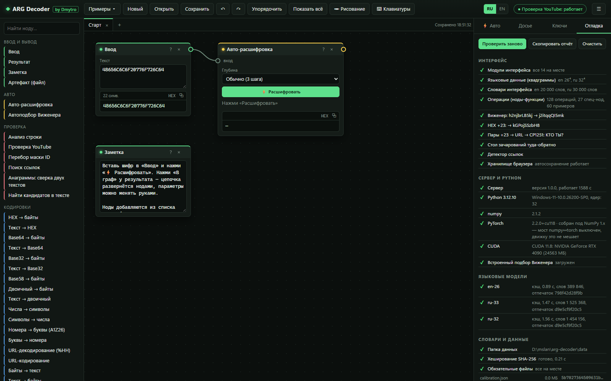<br>
<b>Вкладка отладки.</b> Модули, самотесты, Python, numpy, PyTorch, CUDA, время загрузки моделей, хеши словарей; одна кнопка копирует отчёт.</td>
</tr>
<tr>
<td>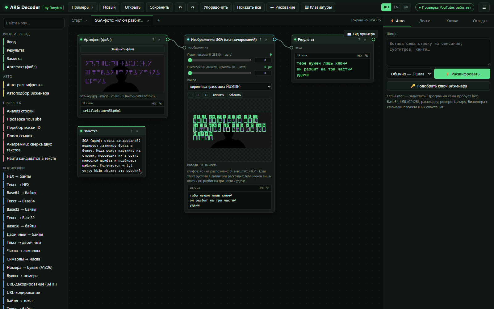<br>
<b>SGA на тёмной фотографии.</b> Бинаризация по Оцу отделяет знаки стола зачарований от тёмного фона с силуэтом, и читалка переводит их обратно в русский текст.</td>
<td>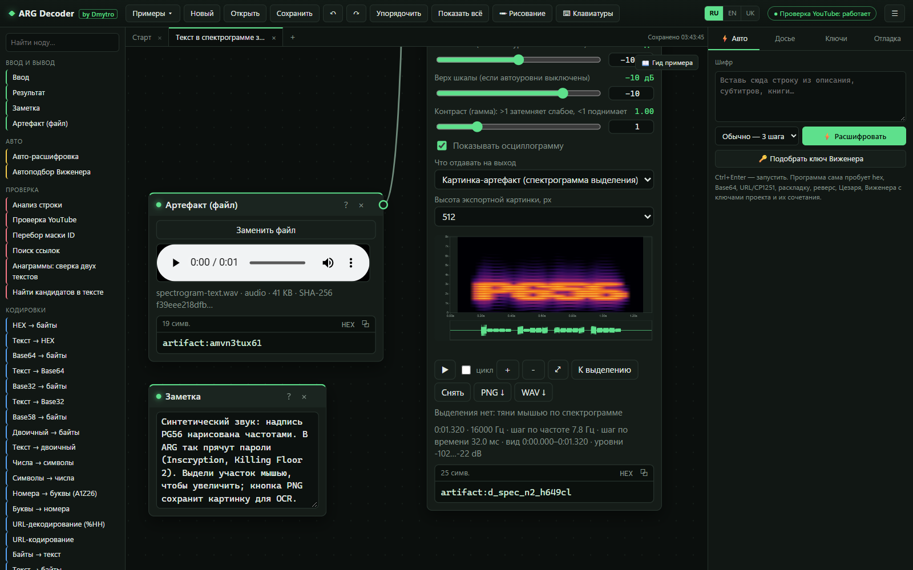<br>
<b>Текст, спрятанный в звуке.</b> На спектрограмме видна надпись PG56, нарисованная частотами. Выделите участок, чтобы увеличить, или сохраните PNG для OCR; рядом декодеры Морзе, DTMF и SSTV.</td>
</tr>
</table>

## 🧰 Возможности

**167 нод:** 133 операции (они же — шаги автопоиска) и 34 специальные ноды. У каждой ноды есть карточка **?** с примером «до/после» и ссылкой на Википедию. Полный список с параметрами — в [справочнике функций](docs/FUNCTIONS.ru.md) ([EN](docs/FUNCTIONS.md) · [UK](docs/FUNCTIONS.uk.md)).

| Область | Основное |
|---|---|
| **Кодировки** | HEX, Base64/32/58/85/91, двоичная, восьмеричная, числа ↔ символы со сдвигом (+23), A1Z26 и по модулю 26, URL (UTF-8 / CP1251), экранирование, Морзе, EBCDIC, uuencode, quoted-printable, Punycode, zlib / gzip / сырой deflate (формат определяется сам, размер ограничен, контрольные суммы проверяются) |
| **Классические шифры** | Цезарь (26/32/33 буквы), ROT-n, Атбаш, аффинный, подстановка, Виженер / Гронсфельд, Бофорт, автоключ, Порта, Bifid, Trifid, ADFGVX, Плейфер, «четыре квадрата», Хилл, Chaocipher, XOR, Энигма I/M3/M4 |
| **Перестановки** | «забор» (rail fence), столбцовая (с поиском неизвестного порядка столбцов), Мышковского, скитала, маршрутная, поворот и отражение сетки |
| **ARG и Minecraft** | зачарованный стол (SGA), квадрат Полибия, тап-код, Бэкон, клавиатура телефона, leet, раскладки EN ↔ RU / UK, коды § Minecraft, руны, Брайль, пигпен, фонетический алфавит НАТО |
| **Скрытое** | буквы-двойники, символы нулевой ширины, акростих, книжный шифр (с точными пробелами), регистр букв → биты |
| **Изображения** | уровни, подъём теней, гамма, каналы, порог (Оцу), обрезка/поворот, битовые плоскости, LSB, метаданные, разность/XOR/смешивание двух изображений, OCR (шрифт Minecraft → RapidOCR по желанию → tesseract; EN/RU/UK, сырые ответы и рамки строк сохраняются), цифры шрифта Minecraft, читалка SGA, QR (с восстановлением поисковых узоров), группы битов → строки сетки → изображение |
| **Аудио и видео** | спектрограмма + осциллограмма, Морзе, DTMF, SSTV (Robot 36, Martin, Scottie; режим по VIS или по периоду строки), импорт сырого PCM, покадровый просмотр видео с извлечением кадров и звука |
| **Файлы** | формат по сигнатуре, данные после конца файла, вложенные файлы, строки, ZIP/JAR с ZipCrypto и вложенными архивами, RAR 4/5 (и с зашифрованными заголовками) и 7z (и AES) через 7-Zip WebAssembly, константы Java-классов, просмотр логов, байты ↔ файл, двоичная склейка частей файла |
| **Хеши и криптография** | MD5, SHA-1/256/512, CRC32, сверка хеша с кандидатами, инспектор и расшифровка OpenSSL `Salted__` (AES, RC4), сырой RC4 |
| **Ссылки и идентификаторы** | обычные, «обезвреженные» и перевёрнутые URL, идентификаторы YouTube/Drive/Catbox/Pastebin, проверка существования по запросу, перебор по маске идентификатора |
| **Рабочее пространство** | доски (вкладки), слой рисования, экранные клавиатуры, файлы проекта с вложениями, банк ключей, профили, отмена/повтор, копирование и вставка между досками |

## 🤖 Автопоиск

Панель **⚡ Авто** и нода *Авто-расшифровка* запускают лучевой поиск (beam search) по цепочкам до четырёх шагов (собственные пробы есть у 58 из 133 операций, остальные — ручные ноды или требуют ключа); результаты оцениваются языковыми моделями английского, русского и украинского (квадрограммы + словари) и по структуре (ссылки, идентификаторы, координаты, пути к файлам, числа).

- **Честные статусы.** Каждый результат — *уверенно*, *вероятно*, *формат распознан*, *часть входа* или *гипотеза*, а поиск завершается вердиктом, в том числе **«ответ не определён»**. Проверки формата строгие, а штраф за перебор множества вариантов ослабевает, только когда текст действительно читается.
- **До поиска** точно вычисляется арифметика, хеш-суммы и непрозрачные токены определяются как таковые, распознаются координаты и пути к файлам.
- **Полный движок Виженера на Python** (CPU или CUDA) запускается параллельно, когда вход похож на шифртекст из букв, в рамках лимита времени и с возможностью отмены; у каждого результата указано, откуда он получен.
- **Составные сообщения** (разные строки зашифрованы по-разному) решаются построчно; **неизвестные столбцовые перестановки** подбираются по языку текста, а перемешанные ссылки — по формату адреса; вырезанный фрагмент никогда не выдаётся за ответ на весь вход.
- **Слои формата снимаются сразу**, сколько бы их ни было (Base64 в Base64, hex(hex), %25XX), с пределом глубины и защитой от циклов; Python-движок получает и промежуточные буквенные слои (Base64 → Виженер).
- **Снятый формат — ещё не ответ.** Короткий или нечитаемый вывод декодера — *формат снят, ответ не подтверждён*; перевёрнутая ссылка или ссылка внутри нечитаемого сообщения подтверждает только себя; два одинаково читаемых порядка слов делают лидера *вероятным*.

Измерено вслепую (нейтральный профиль, пустой банк ключей, без ответа и ключа) на независимом наборе ревью от 24.10.2026 и на картинках OCR; подробности и машиночитаемые результаты — в итоговом отчёте:

| | Было | Стало |
|---|---:|---:|
| Сгенерированный набор ревью, 599 зашифрованных входов: точный ответ первым | 507 | **578** |
| … лидер ошибочно помечен «уверенно» | 29 | **0** |
| Неизвестная перестановка столбцов (18 входов) | 3 | **14** |
| Виженер в Base64 через настоящий сервер (3) | 0 | **3** |
| Новые независимые картинки OCR (34): точно | 25 | **34** (авто с RapidOCR) |

## 🧩 Примеры и досье

В меню **Примеры** лежат **75 готовых досок** по задокументированным решениям реальных ARG (OldRoot, HERMatrix, Endermite, Cicada 3301, Portal, Sombra, Killing Floor 2, Dr. Langeskov, 76543, Steam Winter 2015 и другие), а также учебные наборы. Каждый пример сообщает, как он решается:

| Метка | Значение |
|---|---|
| 🟢 **слепой авто** | автопоиск решает его без ключей и без подсказки с ответом |
| 🟢 **слепой авто + сервер** | то же, с локальным движком на Python |
| 🟡 **ключ** | ручное решение с ключом, полученным на предыдущем этапе |
| 🟡 **контекст** | вычислительную часть делает программа; нужен шаг человека |

На вкладке **Досье** показаны **17 встроенных досье** (по одному на ARG: период, платформа, этапы, приёмы, источники, открытые вопросы). Можно писать собственные досье; они хранятся в файле проекта.

## 🌐 Языки

| Область | Языки |
|---|---|
| Интерфейс | **английский, русский, украинский** (переключатель **RU / EN / UK** в верхней панели; по умолчанию язык выбирается по языку браузера) |
| Документация | английский, русский, украинский |
| Языковая оценка в автопоиске | английский, русский, украинский |
| Решатели Виженера (в браузере и на Python) | en-26, ru-32/33, uk-32/33, выбираются автоматически |
| Исправление раскладки клавиатуры | EN ↔ RU, EN ↔ UK |
| OCR | английский, русский, украинский |

## 📚 Документация

| Документ | Что внутри |
|---|---|
| [Как это работает](docs/HOW-IT-WORKS.ru.md) · [EN](docs/HOW-IT-WORKS.md) · [UK](docs/HOW-IT-WORKS.uk.md) | установка, граф нод, оценка текста, автопоиск и его статусы, движки Виженера, OCR, SGA, SSTV, файлы, безопасность |
| [Справочник функций](docs/FUNCTIONS.ru.md) · [EN](docs/FUNCTIONS.md) · [UK](docs/FUNCTIONS.uk.md) | каждая операция и нода с параметрами, каждый пример, досье и клавиатура (генерируется из кода) |
| [CHANGELOG](CHANGELOG.md) · [ROADMAP](ROADMAP.md) | что изменилось и что ещё открыто |

## 🔒 Приватность: что уходит в сеть

Почти всё происходит локально. Сервер слушает только `127.0.0.1`, проверяет заголовок `Host` и требует заголовок, который отправляет только сам интерфейс, поэтому другие сайты в вашем браузере не смогут с ним связаться. Никакой телеметрии, учётных записей и скриптов с CDN.

| Что | Когда | Куда |
|---|---|---|
| Первая настройка | только при первом запуске | python.org (Python в Windows), PyPI (numpy, необязательный PyTorch), релиз на GitHub (словари) |
| Установка OCR | первый запуск (или `launcher.py --ocr`) | PyPI (RapidOCR, ONNX Runtime), modelscope.cn (три модели ONNX, сверка SHA-256) |
| Проверка YouTube | только когда вы нажмёте | `youtube.com/oembed` |
| Проверка обновлений | при запуске, не чаще раза в 6 часов (выключается в «Отладке») | `api.github.com` (список релизов), затем файлы релиза на `github.com`, когда вы нажмёте «Обновить» |
| Проверка ссылки | только когда вы нажмёте | фиксированный список известных файловых хостингов и пастбинов; перенаправления никогда не выполняются |
| Википедия в справочных карточках | только когда вы щёлкнете | ваш браузер |

## ⚠ Известные ограничения

- **Энигме** и другим машинам с ключом нужны настройки из загадки: автопоиск их не перебирает.
- **Короткие шифры с ключом** без ключа не определяются однозначно: программа показывает кандидатов и говорит «ответ не определён», а не гадает.
- **Нет** OpenPGP, OutGuess, распознавания речи и собственного декодера штрихкодов, кроме QR (для них используется `BarcodeDetector` браузера).
- Режимы SSTV Robot 72, PD и Scottie DX не реализованы; декодированная картинка — результат для проверки, а не доказательство.
- OCR, движку на Python и проверке ссылок нужен локальный сервер (не `file://`).

## ✅ Тесты и разработка

```bash
node --test                                              # 554 tests: engine, solver, examples, images, audio, files, OCR, archives, i18n
python -m unittest discover -s tests -p "test_*.py"      # server, data installer, Vigenère engine
node tools/check_i18n.js                                 # interface strings outside T('ru', 'en')
node tools/i18n_uk.js check                              # Ukrainian dictionary is complete
node tools/gen_functions_doc.js                          # rebuild docs/FUNCTIONS*.md
```

Тесты на оригинальных медиа ARG (записи SSTV, QR, половины PDF, RAR) запускаются, когда папка с этими файлами указана в `ARGDEC_ORIGINALS`; иначе они пропускаются.

<details>
<summary><b>Структура проекта</b></summary>

```
Start-Windows.bat / Start-Mac.command / start.sh   one-click start (first run sets everything up)
Enable-GPU-Windows.bat     PyTorch with CUDA (optional)
launcher.py                picks Python, installs dependencies, starts the server
setup_data.py              downloads and checks the dictionaries (SHA-256)
server.py / backend.py     local server (127.0.0.1 only) and the Python Vigenère engine jobs
updater.py / ed25519_ref.py   exact build, update check, signed install with rollback
tools/release.py           builds and signs a release (author only)
vigenere/                  built-in Vigenère solver (MIT, by Dmytro)
data/                      corpora, EN/RU/UK dictionaries, language-model cache (~300 MB, downloaded)
docs/                      HOW-IT-WORKS, FUNCTIONS (EN/RU/UK), screenshots
tests/                     Node and Python tests
tools/                     language data, i18n, docs and data-archive builders
web/index.html             the interface
web/js/solver*.js          auto search: beam search, evidence and statuses, engines, crackers
web/js/ops*.js             operations
web/js/i18n*.js            interface languages (the Ukrainian dictionary is generated)
web/js/image/, media/, files/   images, audio/video, files
web/vendor/                tesseract.js 5.1.1 (eng/rus/ukr), jsQR 1.4.0
```
</details>

## ⚖ Лицензия и благодарности

**Лицензия: [MIT](LICENSE)**, © 2026 Dmytro. Встроенные сторонние компоненты и скачиваемые данные сохраняют свои лицензии (ниже и в [THIRD_PARTY_NOTICES.md](THIRD_PARTY_NOTICES.md)).

**Автор:** Dmytro.

| Встроенный компонент | Версия | Лицензия | Для чего |
|---|---|---|---|
| [tesseract.js](https://github.com/naptha/tesseract.js) + core | 5.1.1 | Apache-2.0 | локальный OCR |
| [tessdata_fast](https://github.com/tesseract-ocr/tessdata_fast) (eng, rus, ukr) | 4.1.0 | Apache-2.0 | языковые данные OCR |
| [jsQR](https://github.com/cozmo/jsQR) | 1.4.0 | Apache-2.0 | QR-коды |
| [7-Zip WebAssembly](https://github.com/use-strict/7z-wasm) (7-Zip 24.09) | 1.2.0 | LGPL-2.1+ с ограничением unRAR | распаковка RAR/7z |

Источники данных и их лицензии перечислены в [THIRD_PARTY_NOTICES.md](THIRD_PARTY_NOTICES.md).

## 🙏 Благодарности

Огромное спасибо **Polus_Landau** за помощь в решении ARG и за идеи, которые определили облик этого инструмента.
