<h1 align="center">🧩 ARG Decoder</h1>

<p align="center">
  <b>Локальна робоча дошка з вузлів для розв'язання ARG-головоломок</b><br>
  <sub>шифри · кодування · зображення · звук · відео · файли · хеші — на одному полотні, з чесним автопошуком<br>
  <i>by Dmytro</i></sub>
</p>

<p align="center">
  
  
  
  
  
  
  
  
</p>

<p align="center">
  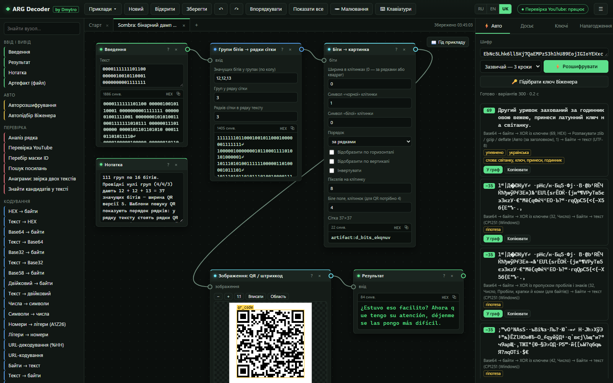
</p>

<p align="center">
  <a href="#-встановлення"><b>Встановлення</b></a> ·
  <a href="#-знімки-екрана">Знімки екрана</a> ·
  <a href="#-можливості">Можливості</a> ·
  <a href="#-автопошук">Автопошук</a> ·
  <a href="#-приклади-та-досьє">Приклади</a> ·
  <a href="#-мови">Мови</a> ·
  <a href="#-документація">Документація</a> ·
  <a href="#-приватність-що-виходить-в-інтернет">Приватність</a> ·
  <a href="#-тести-та-розробка">Тести</a>
</p>

<p align="center">
  <a href="README.md">English</a> · <a href="README.ru.md">Русский</a> · <b>Українська</b>
</p>

---

ARG Decoder — універсальний інструмент для ігор в альтернативній реальності. Ви вставляєте рядок з опису відео, субтитрів, книги чи ігрового логу, а програма сама перебирає ланцюжки відомих перетворень, повідомляє, наскільки впевнена, і розгортає будь-який ланцюжок у вузли, які можна редагувати. Зображення, звук, відео та довільні файли живуть на тому самому полотні, тож головоломка, що починається з темного кадру й закінчується шифртекстом Віженера, залишається на одній дошці. Усе працює на вашому комп'ютері.

## ⚡ Встановлення

### 1. Отримайте програму

| Спосіб | Що зробити |
|---|---|
| **Завантажити програму** (рекомендовано, Git не потрібен) | 1. Відкрийте [останній реліз](https://github.com/dmytro1253/arg-decoder/releases/latest).<br>2. У розділі **Assets** завантажте **`arg-decoder-X.Y.Z.zip`**: лише цей файл, не «Source code» і не `.build.json` / `.build.sig` (вони потрібні самій програмі).<br>3. Розпакуйте куди завгодно, наприклад на робочий стіл.<br>Така копія оновлюється сама. **Code → Download ZIP** на головній сторінці теж працює, але без підписаного списку файлів програма не знає своєї точної збірки |
| **Клонувати через Git** (якщо змінюєте код) | `git clone https://github.com/dmytro1253/arg-decoder.git` і `cd arg-decoder`. Оновлюється тією самою кнопкою, поки в клоні немає власних змін |

**Що завантажувати з релізу.** Лише **`arg-decoder-X.Y.Z.zip`**. Решта файлів не для вас:

| Файл у релізі | Що це |
|---|---|
| `arg-decoder-X.Y.Z.zip` | **сама програма.** Розпакуйте й запустіть файл запуску для своєї системи |
| `arg-decoder-X.Y.Z.build.json` | підписаний список файлів збірки; програма завантажує його сама, щоб перевірити оновлення ще до завантаження архіву |
| `arg-decoder-X.Y.Z.build.sig` | підпис цього списку, теж для програми |
| Source code (zip) / Source code (tar.gz) | GitHub додає їх до кожного релізу сам. Голі сирці без підписаного списку файлів: програма працює, але не знає своєї точної збірки |

У релізі `data-v1` лежать словники; перший запуск завантажує їх сам, вручну звідти нічого завантажувати не треба.

Уже стоїть стара версія? Нічого завантажувати не треба: програма сама запропонує нову під час запуску (див. [Оновлення](#4-оновлення)).

### 2. Запустіть: один подвійний клік встановлює все

| Система | Файл запуску | Примітки |
|---|---|---|
| **Windows** | **`Start-Windows.bat`** | Нічого не треба встановлювати заздалегідь. Якщо Python немає, офіційний вбудований Python (~11 МБ) завантажується в теку програми. Права адміністратора не потрібні, систему не змінено |
| **macOS** | **`Start-Mac.command`** | Перший раз: правий клік → **Відкрити** → **Відкрити**. Потрібен Python 3.9+ з [python.org](https://www.python.org/downloads/macos/) |
| **Linux** | **`./start.sh`** | Потрібні Python 3.9+ і `python3-venv` |

**Перший запуск робить усе один раз** (потрібен інтернет, приблизно 1–3 хвилини):

1. знаходить відповідний Python або завантажує його (Windows);
2. встановлює numpy;
3. завантажує словники та мовні моделі (**~78 МБ**) і перевіряє кожен файл за SHA-256;
4. запускає самоперевірку рушія Віженера;
5. запускає локальний сервер і відкриває браузер.

**Кожен наступний запуск того самого файлу займає близько 3 секунд.** Не закривайте чорне вікно консолі, поки працюєте: у ньому працює локальний сервер. Закрийте його, щоб вийти.

> **Необов'язковий GPU.** Повний перебір ключів Віженера на відеокарті NVIDIA працює приблизно в 10 разів швидше: двічі клацніть **`Enable-GPU-Windows.bat`** (встановлює PyTorch з CUDA, ~2,5 ГБ) або виконайте `python launcher.py --gpu`.

> **Локальний OCR встановлюється разом із програмою.** Перший запуск встановлює і RapidOCR 3.10.0 з ONNX Runtime у `runtime/ocr-python` (ваш Python не змінюється), і три моделі (~26 МБ) у `data/ocr`, кожну зі звіркою SHA-256. Якщо встановлення не вдалося, OCR працює через tesseract.js, а `python launcher.py --ocr` повторить його; `--no-ocr` пропускає OCR.

### 3. Або встановіть вручну з консолі

```bash
git clone https://github.com/dmytro1253/arg-decoder.git
cd arg-decoder
python -m venv .venv
# Windows: .venv\Scripts\activate     Linux / macOS: source .venv/bin/activate
python -m pip install -r requirements.txt
python setup_data.py          # словники та мовні моделі, перевірені за SHA-256
python server.py              # http://127.0.0.1:8765 відкривається в браузері
```

| Команда | Що робить |
|---|---|
| `python launcher.py` | те саме, що файли запуску: вибрати Python, встановити, перевірити, запустити |
| `python launcher.py --repair` | виконати все налаштування заново |
| `python launcher.py --offline` | нічого не завантажувати |
| `python launcher.py --check` | показати знайдені Python і те, що в них є |
| `python launcher.py --update` | перевірити нову версію, завантажити, звірити підпис і встановити |
| `python launcher.py --check-update` | лише дізнатися, чи є нова версія |
| `python launcher.py --verify` | звірити кожен файл програми з підписаним списком збірки |
| `python launcher.py --rollback` | повернути версію, що стояла до останнього оновлення |
| `python server.py --port 8798 --no-browser` | запустити сервер на іншому порту без відкриття браузера |

Взагалі без Python можна відкрити `web/index.html` напряму: шифри, зображення та приклади працюватимуть; рушій Віженера на Python, OCR і перевірка посилань потребують локального сервера.

### 4. Оновлення

Програма знає свою точну збірку: у релізі лежать `build.json` (версія, коміт і SHA-256 кожного файлу програми) та `build.sig` — підпис Ed25519 цього списку ключем автора. Вкладка **Налагодження** показує версію, коміт, номер збірки й підпис, а кнопка **Перевірити файли** знаходить змінені та зниклі файли.

Під час запуску сторінка питає локальний сервер, чи немає новішого релізу (GitHub питають не частіше ніж раз на 6 годин; перевірку можна вимкнути в **Налагодженні**, а `--offline` вимикає її). З'являється смуга з кнопкою **Оновити**:

1. сервер завантажує архів релізу й перевіряє підпис списку файлів відкритим ключем, вбудованим у програму; підроблений або пошкоджений архів відхиляється, навіть якщо його віддає GitHub;
2. архів розпаковується в `runtime/update/staging`, і кожен файл звіряється з підписаним списком; зайві файли, шляхи `../` і теки `data/`, `runtime/`, `.venv/` відхиляються;
3. **Перезапустити й встановити**: запускач копіює файли, що замінюються або видаляються, у `runtime/update/backup`, пише журнал, встановлює й знову перевіряє кожен файл. За будь-якої помилки все повертається назад; встановлення, перерване вимкненням живлення, відкочується під час наступного запуску. `python launcher.py --rollback` повертає попередню версію.

Словники, проєкти, `runtime/` і `.venv/` не зачіпаються. Видаляються лише файли зі списку попередньої підписаної збірки. **Клон Git** отримує ту саму кнопку «Оновити», без архіву: `git fetch` забирає тег релізу, його коміт має збігтися з комітом у підписаному `build.json`, і клон перемотується вперед (`git merge --ff-only`). Незакомічені зміни або власні коміти поверх релізу блокують оновлення (смуга пояснює чому); відкат — `git reset --keep`.

<details>
<summary><b>Що робить лаунчер докладно</b></summary>

1. `launcher.py` вибирає найкращий Python: з numpy і CUDA, інакше з numpy, інакше будь-який 3.9+. У Windows без Python він використовує `runtime/python`, завантажений скриптом `tools/bootstrap-python.ps1`.
2. Якщо в цьому Python немає numpy, він його встановлює (у `.venv` або прямо у вбудований Python).
3. `setup_data.py` завантажує `arg-decoder-data-v1.zip` з релізу на GitHub (адреса в `config/release.json` або змінній `ARGDEC_DATA_URL`), докачує перервані завантаження й перевіряє архів і кожен файл за `data.manifest.json`. Якщо реліз недоступний, дані збираються з оригінальних відкритих джерел.
4. Самоперевірка розшифровує відомий приклад; успіх записується в `runtime/setup-done.json`, тому наступні запуски все це пропускають.
5. `server.py` запускається на `127.0.0.1:8765`, і відкривається браузер.
</details>

## 🖼 Знімки екрана

Усі знімки екрана зроблено в запущеній програмі. Будь-який приклад відкривається прямо за посиланням на кшталт `http://127.0.0.1:8765/?preset=kf2-columnar&lang=uk`.

<table>
<tr>
<td width="50%">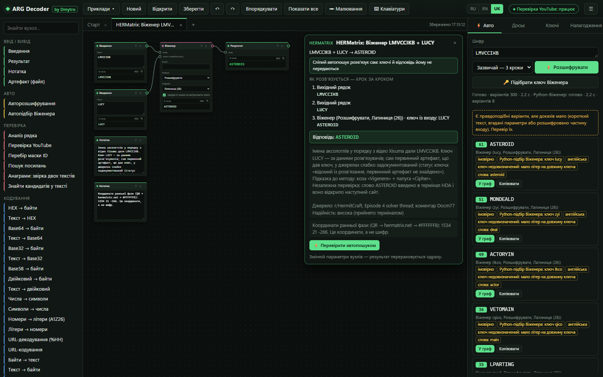<br>
<b>Автопошук з рушієм Python.</b> <code>LMVCCIKB</code> без ключа: локальний розв'язувач на Python знаходить <code>ASTEROID</code> (ключ <code>lucy</code>). Результат позначено як <i>імовірно</i>, а не <i>упевнено</i>: восьми літер замало, щоб довести чотирилітерний ключ.</td>
<td width="50%">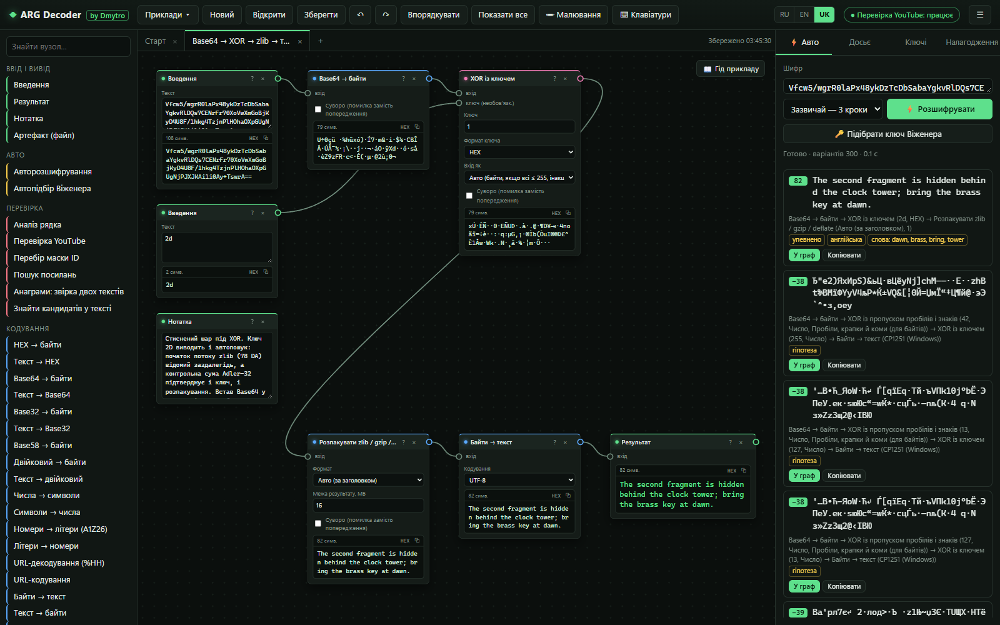<br>
<b>Стиснені шари під XOR.</b> Base64 → XOR → zlib → текст у вигляді графа. Auto знаходить той самий ланцюжок сам: заголовок zlib дає ключ XOR <code>2D</code>, а контрольна сума Adler-32 його підтверджує.</td>
</tr>
<tr>
<td>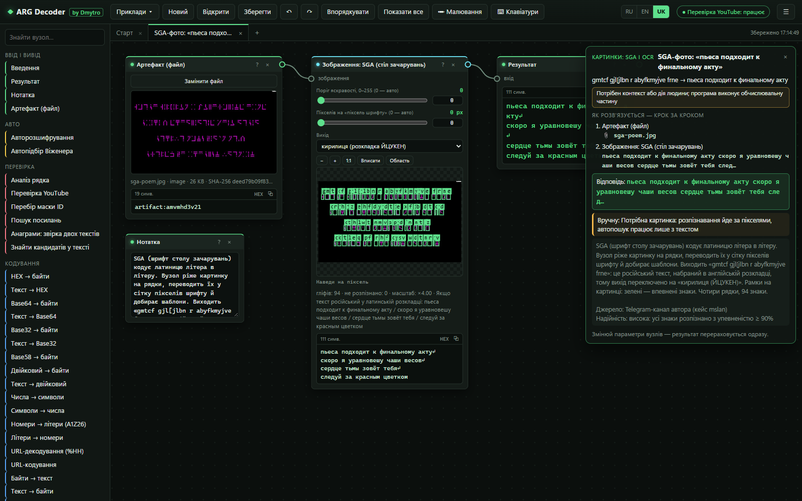<br>
<b>SGA з фото.</b> Зчитувач чарівного столу розпізнає всі 94 гліфи реального фото; російський текст, набраний на англійській розкладці, повертається в кирилицю.</td>
<td>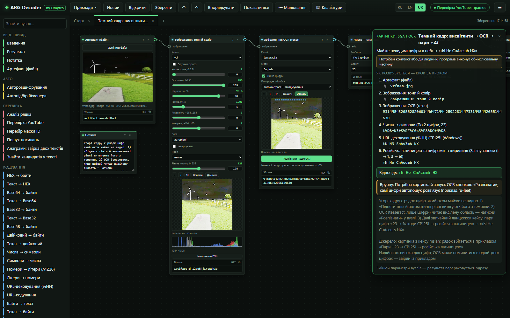<br>
<b>Від темного кадру до відповіді.</b> Підсвічування тіней витягає цифри з чорного неба, локальний OCR їх читає, а ланцюжок парами +23 → CP1251 → російська латинкою завершує справу.</td>
</tr>
<tr>
<td>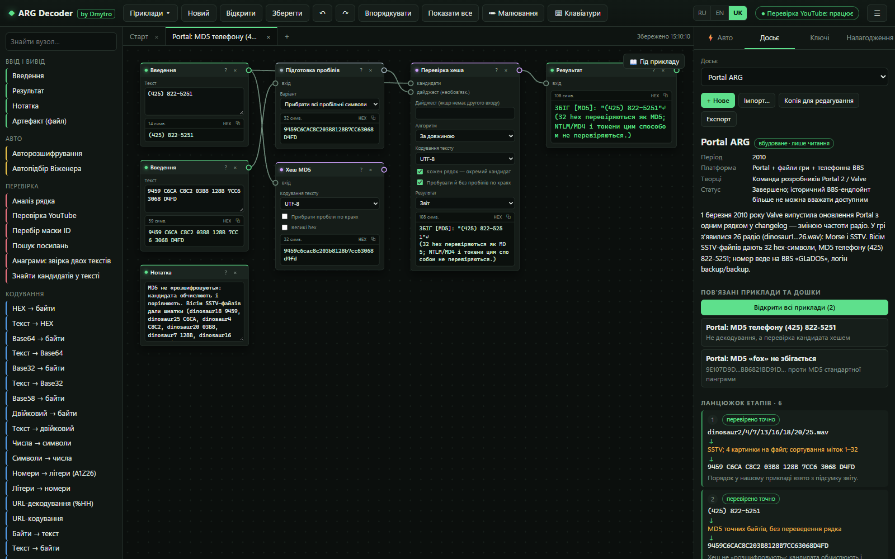<br>
<b>Досьє.</b> 17 вбудованих досьє ARG з етапами, джерелами та надійністю, пов'язані з їхніми прикладами; пишіть власні й зберігайте їх у файлі проєкту.</td>
<td>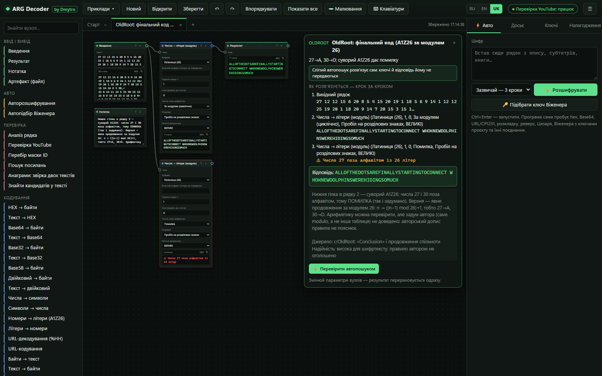<br>
<b>Розбіжності в джерелах показано, а не приховано.</b> Фінальний код OldRoot: строгий A1Z26 не працює на 27 і 30, а гілка за модулем 26 читає повідомлення.</td>
</tr>
<tr>
<td>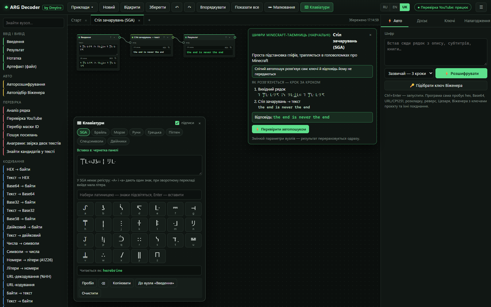<br>
<b>Екранні клавіатури.</b> SGA, Брайль, Морзе, руни, грецька, pigpen, спеціальні символи, схожі літери.</td>
<td>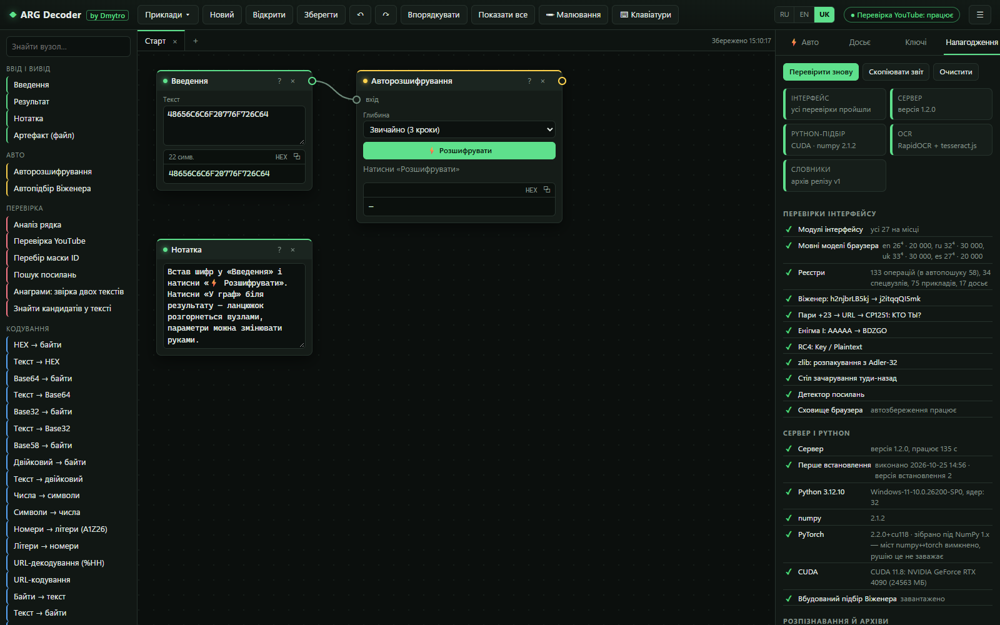<br>
<b>Вкладка «Налагодження».</b> Модулі, самоперевірки, Python, numpy, PyTorch, CUDA, час завантаження моделей, хеші словників; одна кнопка копіює звіт.</td>
</tr>
<tr>
<td>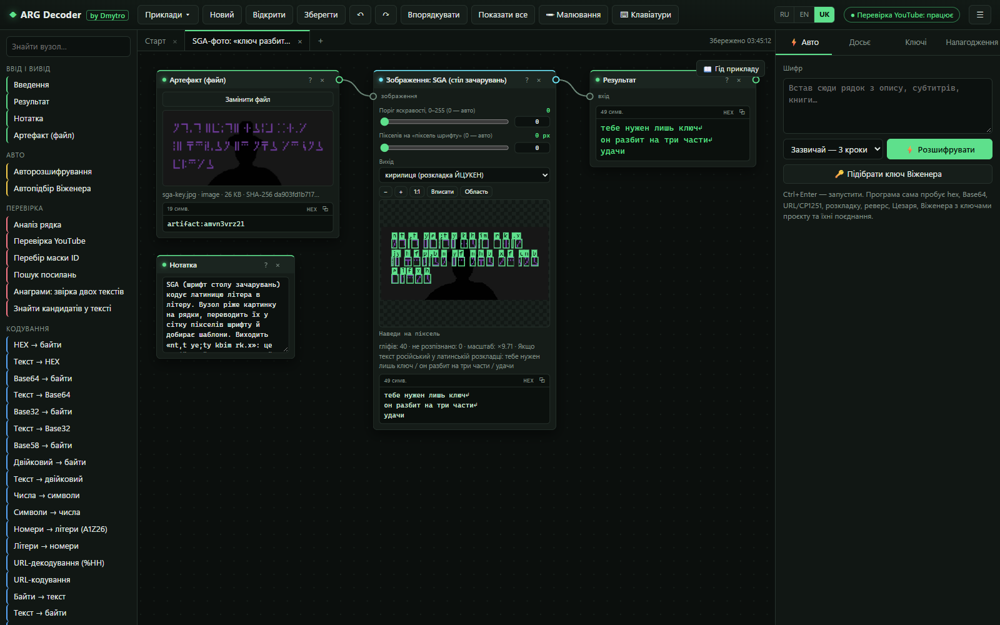<br>
<b>SGA на темній фотографії.</b> Бінаризація за Оцу відокремлює знаки столу зачарувань від темного тла із силуетом, і зчитувач перетворює їх назад на російський текст.</td>
<td>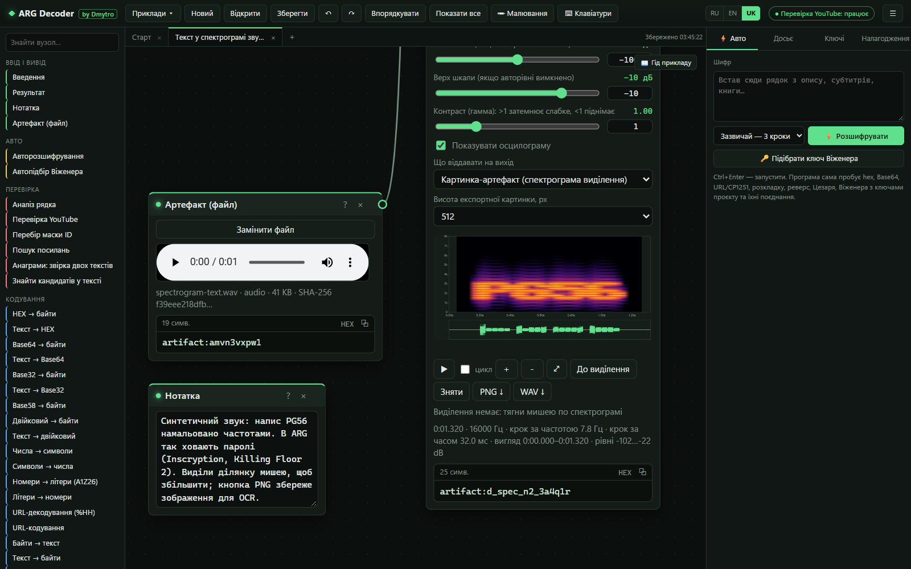<br>
<b>Текст, захований у звуці.</b> На спектрограмі видно напис PG56, намальований частотами. Виділіть ділянку, щоб збільшити, або збережіть PNG для OCR; поруч декодери Морзе, DTMF і SSTV.</td>
</tr>
</table>

## 🧰 Можливості

**167 вузлів:** 133 операції (вони ж кроки автопошуку) і 34 спеціальні вузли. Кожен вузол має картку **?** з прикладом «до/після» і посиланням на Вікіпедію. Повний список з параметрами — у [довіднику функцій](docs/FUNCTIONS.uk.md) ([EN](docs/FUNCTIONS.md) · [RU](docs/FUNCTIONS.ru.md)).

| Напрям | Основне |
|---|---|
| **Кодування** | HEX, Base64/32/58/85/91, двійкове, вісімкове, числа ↔ символи зі зсувом (+23), A1Z26 і за модулем 26, URL (UTF-8 / CP1251), escape-послідовності, Морзе, EBCDIC, uuencode, quoted-printable, Punycode, zlib / gzip / сирий deflate (формат визначається сам, розмір обмежено, контрольні суми перевіряються) |
| **Класичні шифри** | Цезар (26/32/33 літери), ROT-n, Атбаш, афінний, підстановка, Віженер / Гронсфельд, Бофор, автоключ, Порта, Бифід, Трифід, ADFGVX, Плейфер, чотири квадрати, Гілл, Хаосіфер, XOR, Енігма I/M3/M4 |
| **Перестановки** | рейковий паркан, стовпчикова (з пошуком невідомого порядку стовпців), Мишковський, сцитала, маршрутна, поворот/віддзеркалення сітки |
| **ARG і Minecraft** | чарівний стіл (SGA), Полібій, стукіт (tap code), Бекон, клавіатура телефону, leet, розкладки клавіатури EN ↔ RU / UK, коди § у Minecraft, руни, Брайль, pigpen, фонетичний алфавіт НАТО |
| **Приховане** | схожі літери, символи нульової ширини, акровірш, книжковий шифр (з точними пробілами), регістр літер → біти |
| **Зображення** | рівні, підсвічування тіней, гамма, канали, поріг (Оцу), обрізання/поворот, бітові площини, LSB, метадані, різниця/XOR/змішування двох зображень, OCR (шрифт Minecraft → RapidOCR за бажанням → tesseract; EN/RU/UK, сирі відповіді й рамки рядків зберігаються), цифри шрифту Minecraft, зчитувач SGA, QR (з виправленням пошукових візерунків), групи бітів → рядки сітки → зображення |
| **Звук і відео** | спектрограма + хвиля, Морзе, DTMF, SSTV (Robot 36, Martin, Scottie; режим за VIS або за періодом рядка), імпорт сирого PCM, покадровий перегляд відео з витягом кадрів і звуку |
| **Файли** | формат за сигнатурою, дані після кінця файлу, вбудовані файли, рядки, ZIP/JAR з ZipCrypto і вкладеними архівами, RAR 4/5 (і із зашифрованими заголовками) та 7z (і AES) через 7-Zip WebAssembly, константи класів Java, перегляд логів, байти ↔ файл, бінарне зшивання частин файлу |
| **Хеші та криптографія** | MD5, SHA-1/256/512, CRC32, звірка хешу з кандидатами, інспектор і розшифрування OpenSSL `Salted__` (AES, RC4), сирий RC4 |
| **Посилання та ідентифікатори** | звичайні, дефанговані та зворотні URL, ідентифікатори YouTube/Drive/Catbox/Pastebin, перевірка існування на вимогу, перебір за маскою ідентифікатора |
| **Робочий простір** | дошки (вкладки), шар малювання, екранні клавіатури, файли проєкту з вкладеннями, банк ключів, профілі, скасування/повтор, копіювання/вставлення між дошками |

## 🤖 Автопошук

Панель **⚡ Авто** і вузол *Авторозшифрування* запускають променевий пошук (beam search) по ланцюжках (власні проби мають 58 із 133 операцій, решта — ручні вузли або потребують ключа) до чотирьох кроків, оцінюючи їх англійською, російською та українською мовними моделями (квадраграми + словники) і за структурою (посилання, ідентифікатори, координати, шляхи до файлів, числа).

- **Чесні статуси.** Кожен результат — *упевнено*, *імовірно*, *формат розпізнано*, *частина введення* або *гіпотеза*, а пошук завершується вердиктом, зокрема **«відповідь не визначено»**. Перевірки формату строгі, а штраф за перебір багатьох варіантів зникає лише тоді, коли текст справді читається.
- **Перед пошуком** програма точно обчислює арифметику, позначає дайджести хешів і непрозорі токени як такі та розпізнає координати й шляхи до файлів.
- **Повний рушій Віженера на Python** (CPU або CUDA) запускається паралельно, коли введення схоже на шифртекст із літер, у межах бюджету часу й зі скасуванням; кожен результат показує, звідки він узявся.
- **Складені повідомлення** (різні рядки зашифровано по-різному) розв'язуються рядок за рядком; **невідомі стовпчикові перестановки** перебираються за мовою тексту, а перемішані посилання — за форматом адреси; вирізаний фрагмент ніколи не видається за відповідь на все введення.
- **Шари формату знімаються одразу**, скільки б їх не було (Base64 у Base64, hex(hex), %25XX), з межею глибини та захистом від циклів; Python-рушій отримує й проміжні літерні шари (Base64 → Віженер).
- **Знятий формат — ще не відповідь.** Короткий або нечитабельний вивід декодера — *формат знято, відповідь не підтверджено*; перевернуте посилання чи посилання всередині нечитабельного повідомлення підтверджує лише себе; два однаково читабельні порядки слів роблять лідера *імовірним*.

Виміряно наосліп (нейтральний профіль, порожній банк ключів, без відповіді й ключа) на незалежному наборі рев’ю від 24.10.2026 і на зображеннях OCR; подробиці й машиночитні результати — у підсумковому звіті:

| | Було | Тепер |
|---|---:|---:|
| Згенерований набір рев’ю, 599 зашифрованих входів: точна відповідь першою | 507 | **578** |
| … лідера помилково позначено «упевнено» | 29 | **0** |
| Невідома перестановка стовпців (18 входів) | 3 | **14** |
| Віженер у Base64 через справжній сервер (3) | 0 | **3** |
| Нові незалежні зображення OCR (34): точно | 25 | **34** (авто з RapidOCR) |

## 🧩 Приклади та досьє

Меню **Приклади** містить **173 готові дошки** за задокументованими розв'язками реальних ARG (OldRoot, HERMatrix, Endermite, Cicada 3301, Portal, Sombra, Killing Floor 2, Dr. Langeskov, 76543, Steam Winter 2015 та інші), а також навчальні набори. Кожен приклад каже, як його розв'язано:

| Позначка | Значення |
|---|---|
| 🟢 **автопошук наосліп** | автопошук розв'язує його без ключів і без підказки відповіді |
| 🟢 **автопошук наосліп + сервер** | те саме, з локальним рушієм Python |
| 🟡 **ключ** | ручний розв'язок із ключем, отриманим на попередньому етапі |
| 🟡 **контекст** | програма виконує обчислювальну частину; потрібен крок людини |

Ще два набори показують **кожен вузол програми** на справжніх даних, **по одній техніці в прикладі**, щоб новачок бачив одну ідею за раз; тест стежить, щоб жодна операція не лишилася без прикладу:

- **Усі операції** (86 прикладів, у меню за групами): шифри з квадратом (Біфід, Тріфід, ADFGVX, Плейфер…), шифри з ключем (Гілл, Енігма, Порта, біжучий ключ, RC4…), перестановки, символи й алфавіти (пігпен, руни, Брайль, стіл зачарувань), кодування, числа й байти, прихований текст (символи нульової ширини, акровірш, книжковий шифр, посилання), хеші й OpenSSL. Кожен приклад — вхід → вузол → «Результат», а в примітці опис самого вузла та його параметри.
- **Звук, картинки, файли** (12 прикладів): картинка **SSTV** (Robot 36) з QR-кодом, Морзе й DTMF зі звуку, сирі байти PCM; повідомлення в молодших бітах пікселів, бітова площина, число, що проступає після XOR двох шумових кадрів; метадані PNG, ZIP усередині PNG, рядки з файлу, RAR з паролем, архів із двох частин. Вузол **«Результат»** показує картинки й програє звук.

Вкладка **Досьє** показує **17 вбудованих досьє** (по одному на ARG: період, платформа, етапи, техніки, джерела, відкриті питання). Можна писати власні досьє; вони зберігаються у файлі проєкту.

## 🌐 Мови

| Напрям | Мови |
|---|---|
| Інтерфейс | **англійська, російська, українська** (перемикач **RU / EN / UK** у верхній панелі; за замовчуванням — мова браузера) |
| Документація | англійська, російська, українська |
| Мовна оцінка в автопошуку | англійська, російська, українська |
| Розв'язувачі Віженера (браузер і Python) | en-26, ru-32/33, uk-32/33, вибираються автоматично |
| Виправлення розкладки клавіатури | EN ↔ RU, EN ↔ UK |
| OCR | англійська, російська, українська |

## 📚 Документація

| Документ | Що всередині |
|---|---|
| [Як це працює](docs/HOW-IT-WORKS.uk.md) · [EN](docs/HOW-IT-WORKS.md) · [RU](docs/HOW-IT-WORKS.ru.md) | встановлення, граф вузлів, оцінка тексту, автопошук і його статуси, рушії Віженера, OCR, SGA, SSTV, файли, безпека |
| [Довідник функцій](docs/FUNCTIONS.uk.md) · [EN](docs/FUNCTIONS.md) · [RU](docs/FUNCTIONS.ru.md) | кожна операція й вузол з параметрами, кожен приклад, досьє й клавіатура (генерується з коду) |
| [CHANGELOG](CHANGELOG.md) · [ROADMAP](ROADMAP.md) | що змінилося і що ще відкрито |

## 🔒 Приватність: що виходить в інтернет

Майже все відбувається локально. Сервер слухає лише `127.0.0.1`, перевіряє заголовок `Host` і вимагає заголовок, який надсилає тільки інтерфейс, тож інші сайти у вашому браузері не можуть з ним спілкуватися. Жодної телеметрії, облікових записів і скриптів із CDN.

| Що | Коли | Куди |
|---|---|---|
| Перше налаштування | лише під час першого запуску | python.org (Python у Windows), PyPI (numpy, необов'язковий PyTorch), реліз на GitHub (словники) |
| Встановлення OCR | перший запуск (або `launcher.py --ocr`) | PyPI (RapidOCR, ONNX Runtime), modelscope.cn (три моделі ONNX, звірка SHA-256) |
| Перевірка YouTube | лише коли ви натиснете | `youtube.com/oembed` |
| Перевірка оновлень | під час запуску, не частіше ніж раз на 6 годин (вимикається в «Налагодженні») | `api.github.com` (список релізів), потім файли релізу на `github.com`, коли ви натиснете «Оновити» |
| Перевірка посилань | лише коли ви натиснете | фіксований список відомих файлових хостингів і сервісів вставки тексту; переспрямування ніколи не виконуються |
| Вікіпедія в довідкових картках | лише коли ви клацнете | ваш браузер |

## ⚠ Відомі обмеження

- **Енігмі** та іншим машинам із ключем потрібні налаштування із загадки: автопошук їх не перебирає.
- **Короткі шифри з ключем** без ключа недовизначені: програма показує кандидатів і каже «відповідь не визначено», замість того щоб вгадувати.
- **Немає** OpenPGP, OutGuess, розпізнавання мовлення та власного декодера штрихкодів, окрім QR (для них використовується `BarcodeDetector` браузера).
- Режими SSTV Robot 72, PD і Scottie DX не реалізовано; декодоване зображення — це результат для перевірки, а не доказ.
- OCR, рушій Python і перевірка посилань потребують локального сервера (не `file://`).

## ✅ Тести та розробка

```bash
node --test                                              # 757 тестів: рушій, розв'язувач, приклади, зображення, звук, файли, OCR, архіви, i18n
python -m unittest discover -s tests -p "test_*.py"      # сервер, інсталятор даних, рушій Віженера
node tools/check_i18n.js                                 # рядки інтерфейсу поза T('ru', 'en')
node tools/i18n_uk.js check                              # український словник повний
node tools/gen_functions_doc.js                          # перебудувати docs/FUNCTIONS*.md
```

Тести на оригінальних медіа ARG (записи SSTV, QR, половини PDF, RAR) запускаються, коли теку з цими файлами вказано в `ARGDEC_ORIGINALS`; інакше їх пропущено.

<details>
<summary><b>Структура проєкту</b></summary>

```
Start-Windows.bat / Start-Mac.command / start.sh   запуск одним кліком (перший запуск усе налаштовує)
Enable-GPU-Windows.bat     PyTorch з CUDA (необов'язково)
launcher.py                вибирає Python, встановлює залежності, запускає сервер
setup_data.py              завантажує й перевіряє словники (SHA-256)
server.py / backend.py     локальний сервер (лише 127.0.0.1) і завдання рушія Віженера на Python
updater.py / ed25519_ref.py   точна збірка, перевірка оновлень, підписане встановлення з відкатом
update_git.py              те саме оновлення для клону Git (fetch підписаного тегу, перемотка)
tools/release.py           збирає й підписує реліз (лише автор)
vigenere/                  вбудований розв'язувач Віженера (MIT, by Dmytro)
data/                      корпуси, словники EN/RU/UK, кеш мовних моделей (~300 МБ, завантажується)
docs/                      HOW-IT-WORKS, FUNCTIONS (EN/RU/UK), знімки екрана
tests/                     тести на Node і Python
tools/                     мовні дані, i18n, генератори документації та архіву даних
web/index.html             інтерфейс
web/js/solver*.js          автопошук: променевий пошук, докази й статуси, рушії, зламувачі
web/js/ops*.js             операції
web/js/i18n*.js            мови інтерфейсу (український словник генерується)
web/js/image/, media/, files/   зображення, звук/відео, файли
web/vendor/                tesseract.js 5.1.1 (eng/rus/ukr), jsQR 1.4.0
```
</details>

## ⚖ Ліцензія та подяки

**Ліцензія: [MIT](LICENSE)**, © 2026 Dmytro. Вбудовані сторонні компоненти й завантажувані дані зберігають власні ліцензії (нижче й у [THIRD_PARTY_NOTICES.md](THIRD_PARTY_NOTICES.md)).

**Автор:** Dmytro.

| Вбудований компонент | Версія | Ліцензія | Для чого |
|---|---|---|---|
| [tesseract.js](https://github.com/naptha/tesseract.js) + core | 5.1.1 | Apache-2.0 | локальний OCR |
| [tessdata_fast](https://github.com/tesseract-ocr/tessdata_fast) (eng, rus, ukr) | 4.1.0 | Apache-2.0 | мовні дані OCR |
| [jsQR](https://github.com/cozmo/jsQR) | 1.4.0 | Apache-2.0 | QR-коди |
| [7-Zip WebAssembly](https://github.com/use-strict/7z-wasm) (7-Zip 24.09) | 1.2.0 | LGPL-2.1+ з обмеженням unRAR | розпакування RAR/7z |

Джерела даних і їхні ліцензії перелічено в [THIRD_PARTY_NOTICES.md](THIRD_PARTY_NOTICES.md).

## 🙏 Подяка

Щиро дякую **Polus_Landau** за допомогу в розв'язанні ARG та за ідеї, що сформували цей інструмент.
